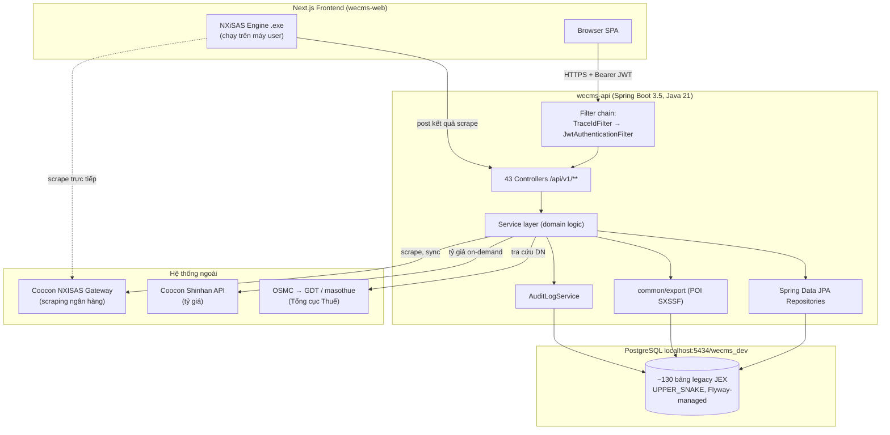
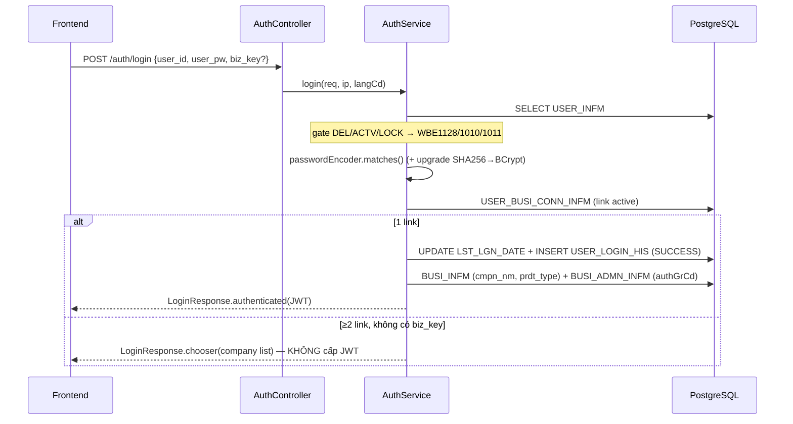
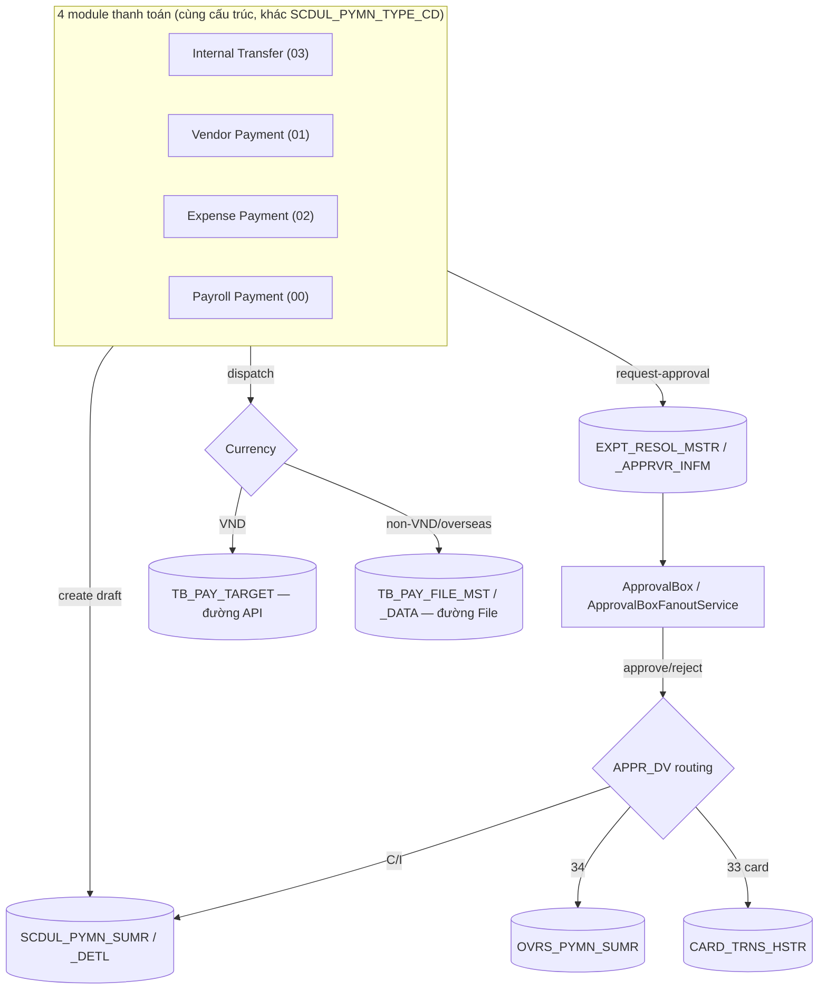
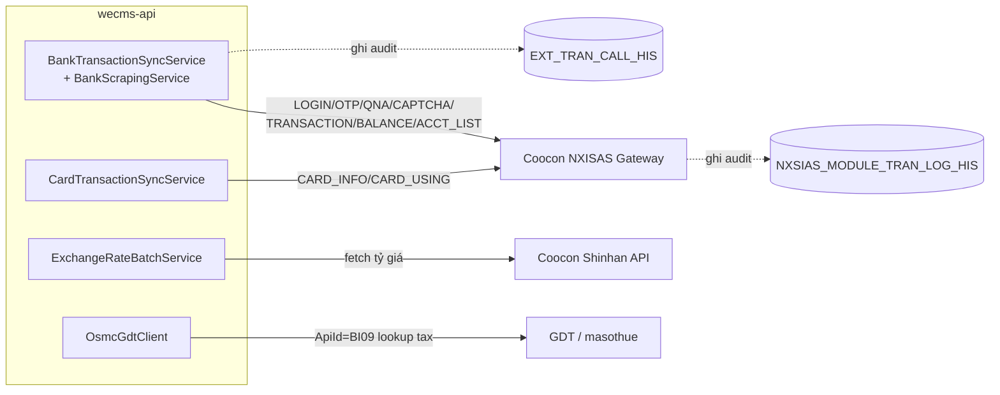

# WeCMS API — Danh mục chức năng toàn hệ thống (Function Catalog)

> Tài liệu tổng hợp **toàn bộ 43 controller / ~329 endpoint (đếm @*Mapping)** của `wecms-api`, mô tả cho mỗi API: chức năng, table đọc, table ghi/update, luồng xử lý, service/API ngoài được gọi. Dựng từ việc đọc code thực tế (controller + service + entity + repository), không suy đoán.
>
> **Cơ sở verify:** đối chiếu lại trên nhánh `sit` (commit `ff955b2`, migration tới `V248`) ngày 2026-06-11 (bản dựng đầu 2026-06-05). Đối chiếu chi tiết theo từng PR ở [`../planning/open-questions/review-crosscheck-sit-2026-06-11.md`](../planning/open-questions/review-crosscheck-sit-2026-06-11.md).
>
> **Quy ước chung:**
> - Mọi route ngoài `/api/v1/auth/login`, `/api/v1/auth/logout`, `/actuator/health` đều **JWT-protected**.
> - **Phân quyền đã BẬT** (từ rollout 2026-06-06): `@EnableMethodSecurity` ON trong `SecurityConfig`; phần lớn controller nghiệp vụ gắn `@PreAuthorize("@menuAuthz.canAccess(<slug>)")` — `MenuAuthorizationGuard` fail-closed (chặn slug lạ / ngoài product-tree của tenant / chưa được grant; ADMIN bỏ qua per-user grant nhưng KHÔNG bỏ qua gate product-tree). Gate dữ liệu per-account qua `AccountAccessGuard` (non-admin cần `ACCT_AUTH_INFO`). Bị chặn → HTTP 403 / `WBE1003`. `EndpointAuthorizationCoverageTest` ép mọi handler ngoài allow-list phải có annotation. Còn 12/43 controller chưa gắn (chủ yếu public/allow-list + vài cái chỉ JWT — xem từng file con).
> - Tenant (`BIZ_KEY`), `USER_ID`, `LANG_CD`, `AUTH_GR_CD`, `PRDT_TYPE` luôn đọc từ `TenantContext` (giải mã từ JWT đã ký) — **không bao giờ** nhận `biz_key` từ wire.
> - Wire JSON là lowercase snake_case (qua `JacksonConfig`); envelope `{ status, data }`, error thêm `timestamp/path/trace_id`.
> - Audit ghi vào `AUDIT_LOGS_INFM` qua `AuditLogService.append` (propagation `REQUIRES_NEW`, fan-out 1 row/locale).

---

## 1. Sơ đồ kiến trúc tổng thể (System Context)



## 2. Kiến trúc phân lớp + luồng request

```mermaid
graph LR
    REQ[HTTP Request] --> TID[TraceIdFilter<br/>tạo trace_id → MDC]
    TID --> JWT[JwtAuthenticationFilter<br/>parse Bearer → TenantContext]
    JWT --> SEC{SecurityConfig<br/>authenticated?}
    SEC -->|401| EP[JwtAuthenticationEntryPoint<br/>WBE1401]
    SEC -->|OK| C[Controller<br/>parse + validate]
    C --> S[Service<br/>@Transactional + business rule]
    S --> R[Repository JPA]
    R --> DB[(PostgreSQL)]
    S -.lỗi.-> GEH[GlobalExceptionHandler<br/>BusinessException→200, validation→200, server→5xx]
    C --> RESP["ApiResponse&lt;T&gt; {status,data}"]
```

## 3. Luồng đăng nhập (Login 2 bước, multi-company)



## 4. Bản đồ module (domain)

| Domain package | Controllers | Phạm vi |
|---|---|---|
| `domain/auth` | AuthController, UserController | Login/me/logout/change-password, user directory |
| `domain/banking` | Account, Report, DailyCashReport, CashFlowReport, ExchangeRate, Transfer | Tra cứu TK, giao dịch, báo cáo, tỷ giá |
| `domain/banking/*` (sub) | BankCredential, BankScraping(nxisas), OwnAccountTransfer, OrganizerRule+SmartOrganizer, SyncHistory, TransferHistory | Credential, scraping, chuyển khoản nội bộ, auto-classify |
| `domain/payment/*` | ApprovalBox, CardTransactions, OverseasPayment, ExpensePayment, InternalTransfer+TransferResult, PayrollPayment, BlockedCharsRule, VendorPayment | Thanh toán + workflow phê duyệt + dispatch ngân hàng |
| `domain/setting/*` | ScreenOption, Environment, FirmBankingSettings, Preferences, BankAccount, ChartOfAccounts, ApprovalLine, Contacts, ErpTrnsHistory, FirmBankingHistory, LoginCredentials, PurposeSettings, UserManagement, VasAccount | Cấu hình tenant |
| `domain/einvoice` | EInvoiceController | Hóa đơn điện tử Sales/Bill |
| `domain/operation` | OperationStatusController | Tra cứu trạng thái DN từ GDT |
| `domain/common/country` | CountryController | Dữ liệu tham chiếu quốc gia |
| `domain/navigation` | NavigationController | Cây menu sau đăng nhập (Product Tree ∩ grant; lọc theo `prdt_type` + `USER_MENU_AUTH_INFM`) |
| `domain/notification` | NotificationController | Thông báo trong app (list / unread-count / mark-read) |

---

## 5. Hạ tầng dùng chung (`common/`)

| Thành phần | Vai trò | Table/đối tượng |
|---|---|---|
| `ApiResponse<T>` + `CommonHead` | Envelope `{status,data}`, success `WBI0000`, error thêm trace | — |
| `JwtTokenProvider` | Phát hành/parse JWT (HS256 ≥32B, HS512 ≥64B), claims `sub/userNm/bizKey/langCd/authGrCd/prdtType` | — |
| `JwtAuthenticationFilter` | Đọc Bearer → đổ `TenantContext` + authority ROLE_ADMIN/USER | — |
| `JwtAuthenticationEntryPoint` | 401 + envelope `WBE1401` khi không hợp lệ | — |
| `TenantContext` | ThreadLocal giữ principal — nguồn duy nhất của biz_key/prdt_type | — |
| `TraceIdFilter` + `GlobalExceptionHandler` | trace_id (JEX format) → MDC + `X-Trace-Id`; funnel exception → HTTP status | — |
| `ExcelExportService` + pipeline | Export XLSX dùng chung, key theo `WEB_SVC_ID`, giao cột với View Setting, cap 50.000 row | `SYS_SCR_OPTION_WECMS`, `USER_SCR_OPTION_WECMS` |
| `AuditLogService` | Ghi audit fan-out 1 row/locale, REQUIRES_NEW, không throw | `AUDIT_LOGS_INFM` |
| `LegacyFunctionRepository` | Funnel gọi `wb_get_next_val` + bank-name resolve (NAPAS/CITAD) | DB functions |
| `MenuAuthorizationGuard` (`@menuAuthz`) | Gate màn hình fail-closed cho `@PreAuthorize` — `canAccess/canAccessAny(<slug>)`; chặn → 403/`WBE1003` | `USER_MENU_AUTH_INFM`, product-tree |
| `AccountAccessGuard` | Gate dữ liệu per-account (non-admin cần `ACCT_AUTH_INFO`); thiếu quyền → 403/`WBE1003` | `ACCT_AUTH_INFO` |

---

## 6. AUTH — `domain/auth`

| Endpoint | Method | Chức năng | Table đọc | Table ghi |
|---|---|---|---|---|
| `/api/v1/auth/login` | POST (public) | Đăng nhập 2 bước multi-company, cấp JWT hoặc chooser | USER_INFM, USER_BUSI_CONN_INFM, BUSI_INFM, BUSI_ADMN_INFM | USER_INFM (upgrade hash), USER_BUSI_CONN_INFM (LST_LGN_DATE), USER_LOGIN_HIS |
| `/api/v1/auth/me` | GET | Snapshot phiên hiện tại để rehydrate | USER_INFM, USER_BUSI_CONN_INFM, BUSI_INFM | — |
| `/api/v1/auth/logout` | POST (public) | Stub — client tự xóa token | — | — |
| `/api/v1/auth/change-password` | POST | Tự đổi mật khẩu (chống tái dùng 3 mật khẩu gần nhất) | USER_INFM, USER_PW_CHG_HIS | USER_INFM, USER_PW_CHG_HIS |
| `/api/v1/users?q=` | GET | Danh bạ user active của tenant (picker approver) | USER_BUSI_CONN_INFM ⋈ USER_INFM | — |

**Mã lỗi auth:** WBE1009 (sai credential), WBE1010 (chưa active), WBE1011 (khóa), WBE1128 (đã xóa), WBE1401 (session expired), WBE2091/WBE_CHANGE_PASSWORD_* (đổi mật khẩu).

---

## 7. BANKING (core) — `domain/banking`

### AccountController `/api/v1/banking`
| Endpoint | Method | Chức năng | Table đọc | Table ghi |
|---|---|---|---|---|
| `/accounts` | GET | Account Inquiry VND/FCY, tổng theo ccy, dropdown bank | ACCT_MSTR, BANK_CERT_INFO, BANK_INFM | — |
| `/accounts/export` | POST | Export XLSX | + View Setting | — |
| `/accounts/register` | POST | Đăng ký TK sau scrape (upsert) | ACCT_MSTR, BANK_CERT_INFO, USER_BUSI_CONN_INFM | ACCT_MSTR, ACCT_AUTH_INFO |
| `/accounts/transactions-sync` (+ `/{sid}/qna|otp|captcha`) | POST | **Scrape NXISAS Coocon** đồng bộ giao dịch | ACCT_MSTR, BANK_CERT_INFO, ACCT_TRNS_HSTR | ACCT_TRNS_HSTR, ACCT_MSTR, EXT_TRAN_CALL_HIS |
| `/accounts/by-bank` | GET | Autocomplete TK rút (firm-banking) | NAPAS_BANK_INFO, ACCT_MSTR | — |
| `/accounts/{seq}/transactions` (+ `/summary`, `/{trns}`) | GET | Lịch sử + tổng + chi tiết giao dịch | ACCT_TRNS_HSTR, ACCT_TRNS_RCV_PAY_INFM | — |
| `.../{trns}/confirm` | PUT/DELETE | Xác nhận / hủy xác nhận giao dịch | ACCT_TRNS_HSTR, ACCT_TRNS_RCV_PAY_INFM | ACCT_TRNS_RCV_PAY_INFM |
| `.../{trns}/reporting-account` | PATCH/DELETE | Gán/xóa chart-of-accounts | ACCT_TRNS_HSTR, CHART_ACCT_INFM | ACCT_TRNS_HSTR |
| `.../{trns}/purpose` `.../vas-account` `.../contact` | PATCH/DELETE | Gán/xóa purpose / VAS / contact | ACCT_TRNS_HSTR, BUSI_USAG_SET_INFM, BUSI_VAS_ACCT_INFM, TRCO_INFM | ACCT_TRNS_RCV_PAY_INFM |
| `.../match-candidates` `.../match` | GET/POST/DELETE | Smart match giao dịch ↔ scheduled payment | ACCT_TRNS_HSTR, SCDUL_PYMN_SUMR(_DETL), BUSI_MATCH_LOG | BUSI_MATCH_LOG, ACCT_TRNS_HSTR, SCDUL_PYMN_SUMR_DETL |
| `/accounts/transactions/export` | POST | Export XLSX lịch sử giao dịch | + View Setting | — |

### Report / Tỷ giá / Transfer
| Endpoint | Method | Chức năng | Trạng thái |
|---|---|---|---|
| `/reports/daily-cash` | GET | Daily Cash (cũ) | **STUB summary**, ledger thực (ACCT_MSTR) |
| `/reports/daily-financial` (+ `/transactions`) | GET | Daily Financial CMC | **Partial** — header/ledger thực, transactions skeleton |
| `/reports/daily-financial-hs` | GET | HAENGSUNG ledger | **STUB** (data hardcode) |
| `/reports/daily-cash-report` (+ `/export`) | GET/POST | Daily Cash mới | Thực — đọc DAILY_CASH_REPT_DAILY_SUMR_DETL, ghi AUDIT_LOGS_INFM |
| `/reports/cash-flow-report` (+ `/export`) | GET/POST | Cash Flow theo cây chart-of-accounts | Thực — CHART_ACCT_INFM + ACCT_TRNS_HSTR/CARD_TRNS_HSTR/OVRS_PYMN_MSTR/SCDUL_PYMN_SUMR |
| `/exchange-rates` (+ `/banks`, `/currencies`) | GET | Tỷ giá | Thực — BANK_EXCH_RATE_INFM; **on-demand fetch Coocon Shinhan** rồi UPSERT |
| `/transfers/own-accounts` | GET | TK cho transfer | **STUB** (không execution) |

> `GET /transfers/history` (deprecated) **đã bị xoá** 2026-06-07 — dùng `GET /api/v1/banking/internal-transfer/transfer-history` (mục 8).

---

## 8. BANKING (sub-modules)

### Bank Credentials `/api/v1/banking/credentials` — CRUD `BANK_CERT_INFO` (password AES-GCM)
GET (list) · POST (create, SEQ_NO MAX+1) · PUT `/{seqNo}` · DELETE `/{seqNo}`.

### Bank Scraping (NXISAS) `/api/v1/banking/scraping` — **gọi Coocon NXISAS gateway**
| Endpoint | Chức năng |
|---|---|
| POST `/account-list` | Scrape danh sách TK từ credential đã lưu (LOGIN→ACCT_LIST) |
| POST `/verify` | Verify credential nhập inline trước khi lưu |
| POST `/{sid}/otp` `/qna` `/captcha` | Resume sau challenge |

Mỗi lần gọi gateway ghi `NXSIAS_MODULE_TRAN_LOG_HIS`. Session in-memory (`NxisasSessionRegistry`).

### Own Account Transfer `/api/v1/banking/own-account-transfer` — **9 endpoint** (engine chạy trên browser, Spring chỉ lưu kết quả)
GET `/source-accounts` · POST `/balance-refresh` · POST `/engine-connection-check` (204) · GET `/napas-bank-info/{cd}` · GET `/target-accounts` · POST `/scraping-result` (idempotent, INSERT NAPAS_REMIT_TRNS_HSTR) · POST `/nxisas/cert-acct-list` · POST `/nxisas/decrypt|encrypt` (pass-through) · POST `/nxisas/logging` (204).
Audit `AUDIT_LOGS_INFM` (wsvc `own-account-transfer`) cho nhóm domain; nhóm nxisas ghi `NXSIAS_MODULE_TRAN_LOG_HIS`.

### Smart Organizer `/api/v1/banking/smart-organizer`
- **Rules** `/rules`: GET · POST · PUT `/{seq}` · DELETE `/{seq}` · POST `/reorder` — CRUD `RMRK_ORG_INFM` (key qua `wb_get_next_val`).
- **Eligibility**: GET `/eligible` (giao dịch khớp rule chưa confirm — native LATERAL JOIN) · POST `/confirm` (bulk INSERT `ACCT_TRNS_RCV_PAY_INFM`).

### Sync History `/api/v1/banking/sync-history` — GET, đọc `EXT_TRAN_CALL_HIS` ⋈ `ACCT_MSTR` (read-only).
### Transfer History `/api/v1/banking/internal-transfer/transfer-history` — GET, đọc `NAPAS_REMIT_TRNS_HSTR` + resolve bank/user (read-only, không audit).

---

## 9. PAYMENT — `domain/payment`



| Sub-module | Base path | Đặc thù |
|---|---|---|
| **Approval Box** | `/payment/approval-box` | GET list+4 tab, approve/reject/withdraw, change approval-line, bulk-approve, export. Ghi EXPT_RESOL_APPRVR_INFM + write-back OVRS/SCDUL |
| **Card Transactions** | `/payment/card-transactions` | ~28 endpoint: sổ giao dịch thẻ, CRUD CARD_MSTR, link e-invoice/receipt, memo, **sync Coocon**, period-limits, request-approval (APPR_DV='33') |
| **Overseas Payment** | `/payment/overseas-payment` | scheduled/result/dispatch, excel upload/preview, OVRS_PYMN_SUMR/_DTLS/_MSTR, CutoffValidator SWIFT |
| **Internal Transfer** | `/payment/internal-transfer` | create draft (+ERP_TRNS_HSTR), request-approval (+attachment EXPT_RESOL_FILE), dispatch, rerun line, results |
| **Vendor / Expense** | `/payment/{vendor\|expense}-payment` | Gần như bản sao Internal Transfer, khác discriminator (`01`/`02`) + audit slug; có banking-match per-line |
| **Payroll** | `/payment/payroll-payment` | Discriminator `00`; **khác** Internal Transfer — banking-match ở mức batch (1:1, không per-line, không unmatch-all) |
| **Blocked Chars Rule** | `/payment/blocked-chars` | GET rule ký tự cấm cho (bank, pymn_type) — drive validation upload |

**Tích hợp ngoài duy nhất trong payment:** `POST /card-transactions/sync` → Coocon/NXISAS.
**Dispatch:** chỉ **GHI bảng lệnh chi** — VND → `TB_PAY_TARGET`; non-VND/Overseas → `TB_PAY_FILE_MST` + `TB_PAY_FILE_DATA` (đều `PROC_STAT='9'`), stamp `TRNF_YN='Y'`. **Việc gửi ngân hàng (NAPAS/CITAD/SWIFT) + lật `PROC_STAT` do JEX dispatch daemon ngoài xử lý** — refactor KHÔNG có HTTP client gửi bank, KHÔNG có EFS engine; bản local-only không gắn daemon nên tiền không thực sự rời TK. `CutoffValidator` chặn ngoài giờ/cuối tuần.

---

## 10. SETTINGS — `domain/setting`

| Sub-module | Base path | Table chính | Audit |
|---|---|---|---|
| **View Setting** | `/screen-options` | SYS_SCR_OPTION_WECMS, USER_SCR_OPTION_WECMS | Không |
| **Environment** | `/settings/environment-settings` | SYS_ENV_SET_INFM, BUSI_ENV_SET_INFM | Không |
| **Firm Banking Settings** | `/settings/firm-banking-settings` | TB_FIRM_CONF (+ view V_FIRM_BANKING_SETTING) | Có (trừ delete) |
| **Preferences** | `/settings/preferences` | BUSI_INFM (+logo file) | Có (update) |
| **Bank Account** | `/settings/bank-account` | ACCT_MSTR, ACCT_AUTH_INFO | Có |
| **Chart of Accounts** | `/settings/chart-of-accounts` | CHART_ACCT_INFM (key wb_get_next_val) | Có |
| **Approval Line** | `/settings/approval-line` | APPR_LINE_INFM(_DETL) | Không |
| **Contacts** | `/settings/contacts` | TRCO_INFM + ADDR/ACCT/OVRS + PGRO + TRCO_INFO_FILE | — (guard WBE1190 in-use) |
| **ERP Transaction History** | `/settings/erp-transaction-history` | ERP_TRNS_HSTR ⋈ USER_INFM | Không (read-only) |
| **Firm Banking History** | `/settings/firm-banking-history` | V_FIRM_BANKING_HISTORY | Không (read-only) |
| **Login Credentials** | `/login-credentials` | BANK_CERT_INFO, GDT_CERT_INFO | Có |
| **Purpose Settings** | `/settings/purpose-settings` | BUSI_USAG_SET_INFM (+V_PURPOSE_IN_USE) | Có |
| **User Management** | `/settings/users` | USER_INFM, USER_BUSI_CONN_INFM, BUSI_ADMN_INFM, USER_MENU_AUTH_INFM | Không |
| **VAS Account** | `/settings/vas-account` | BUSI_VAS_ACCT_INFM | Có |

> Mỗi sub-module CRUD đầy đủ list/detail/create/update/delete; nhiều module có thêm `/export` (XLSX), excel preview/import, file upload/download. Chi tiết từng endpoint xem các section của agent report (đã ghi đầy đủ table đọc/ghi + xử lý).

### Login Credentials — luồng quan trọng
- `POST /login-credentials/bank` find-or-create dedup, password AES-GCM.
- `POST /{type}/{seqNo}/verify-update` → verify qua **NXISAS LOGIN**, không ghi DB.
- `POST /{type}/{seqNo}/reveal` → xác nhận password rồi trả plaintext.
- GET `/{type}/{seqNo}/audit-logs` → đọc AUDIT_LOGS_INFM.

---

## 11. ADD-ON & COMMON

### e-Invoice `/api/v1/addon/einvoices` — đọc/ghi `BUSA_DOC_MSTR` (+ detail/fee/tax)
- GET list Sales(`type=I`)/Bill(`EXPENSE/BILL→'B'`), lọc ngày + keyword, tổng theo ccy.
- POST `/export` + `/export-details` XLSX (provider `addon-sales-einvoices` / `addon-expenses-einvoices`).
- POST `/scrape-results` + `/scrape-detail-results` — nhận kết quả scrape, ghi `BUSA_DOC_MSTR`(/`_DETL`/`EINV_FEE_DETL`/`EINV_TAX_DETL`) + `EXT_TRAN_CALL_HIS`.
- GET `/history` + `/detail-history` — đọc `EXT_TRAN_CALL_HIS`.
- **Lưu ý (PR-036 đã chốt):** `resolveDocType` map `EXPENSE/BILL→'B'`, `SALES→'I'` — ĐÚNG, không phải bug (caveat `EXPENSE→'E'` cũ trong tài liệu là nhầm). `EINV_INVOICESTATUS` vẫn trả raw, lọc status ở FE (IR-4).

### Operation Status `/api/v1/addon/operation-status` — `OPRT_STTS_INFO`
- GET list + POST `/export` (read-only cache).
- **POST `/` (create/persist)** — lưu 1 dòng `OPRT_STTS_INFO` (legacy `aosv_0001_002_c001`); trùng → `WBE_OPERATION_STATUS_DUPLICATE`. (Trước đây thiếu trong catalog — PR-035.)
- **POST `/inquire`** → tra 1 Tax ID qua **OSMC → NXISAS → GDT**; ghi EXT_TRAN_CALL_HIS + NXSIAS_MODULE_TRAN_LOG_HIS.
- **POST `/update`** → re-poll cache, upsert OPRT_STTS_INFO + audit.

### Notification `/api/v1/notifications` — `NOTIFICATION` (scope user+tenant)
- GET `/` (list) · GET `/unread-count` · PUT `/{id}/read` · PUT `/read-all`. Chỉ `authenticated()` (không `@PreAuthorize`). Producer nội bộ best-effort, chưa có endpoint ghi từ ngoài.

### Country `/api/v1/common/countries` — GET, đọc `NATN_INFM` (reference data, không tenant-scope, VN→default_yn='Y').

---

## 12. Tích hợp hệ thống ngoài (External Integrations)



| Service | API ngoài | Endpoint kích hoạt |
|---|---|---|
| `NxisasGatewayClient` | Coocon NXISAS gateway | banking/scraping/*, transactions-sync, card-transactions/sync |
| `ExchangeRateBatchService` | Coocon Shinhan | GET /exchange-rates (on-demand khi hôm nay rỗng) |
| `OsmcGdtClient` | OSMC → GDT (BI09) | operation-status/inquire, /update |
| NXiSAS engine (browser) | Coocon (trực tiếp) | own-account-transfer (Spring chỉ lưu kết quả) |

---

## 13. Bản đồ bảng bị ghi/update (Write map — rút gọn)

| Nhóm bảng | Ghi bởi |
|---|---|
| USER_INFM, USER_BUSI_CONN_INFM, USER_LOGIN_HIS, USER_PW_CHG_HIS, BUSI_ADMN_INFM, USER_MENU_AUTH_INFM | auth, user-management |
| ACCT_MSTR, ACCT_AUTH_INFO, ACCT_TRNS_HSTR, ACCT_TRNS_RCV_PAY_INFM | banking (register/sync/confirm/classify), bank-account |
| BANK_CERT_INFO, GDT_CERT_INFO, BANK_EXCH_RATE_INFM | credentials, login-credentials, exchange-rate (on-demand) |
| BUSI_MATCH_LOG, RMRK_ORG_INFM, NAPAS_REMIT_TRNS_HSTR | smart-organizer, own-account-transfer |
| SCDUL_PYMN_SUMR(_DETL), EXPT_RESOL_MSTR/_APPRVR_INFM/_FILE, TB_PAY_TARGET, TB_PAY_FILE_MST/_DATA, CARD_MSTR, CARD_TRNS_HSTR, OVRS_PYMN_SUMR/_DTLS | payment (4 module + card + overseas) |
| TB_FIRM_CONF, BUSI_INFM, CHART_ACCT_INFM, APPR_LINE_INFM(_DETL), TRCO_INFM (+sub), BUSI_USAG_SET_INFM, BUSI_VAS_ACCT_INFM, BUSI_ENV_SET_INFM, SYS/USER_SCR_OPTION_WECMS | settings |
| OPRT_STTS_INFO, EXT_TRAN_CALL_HIS, NXSIAS_MODULE_TRAN_LOG_HIS | operation-status, scraping/sync (audit) |
| AUDIT_LOGS_INFM | mọi feature CRUD có audit (qua AuditLogService) |

---

*Dựng từ đọc code thực tế 2026-06-05; **đối chiếu + cập nhật lại toàn bộ trên nhánh `sit` (commit `ff955b2`, migration `V248`) ngày 2026-06-11.** Khi code di chuyển, cập nhật lại file này (kèm commit hash đã verify).*
