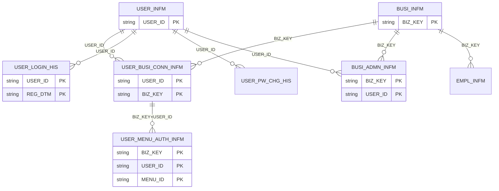
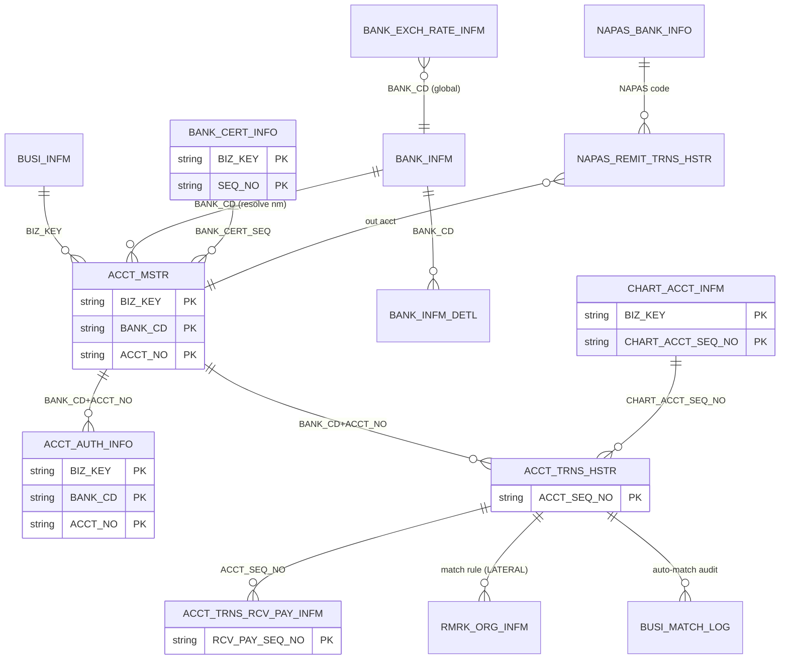
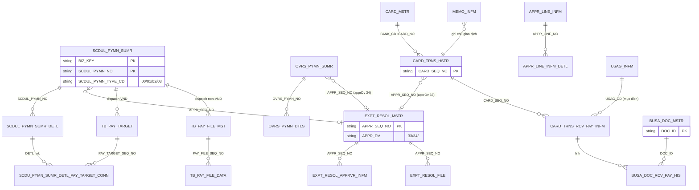
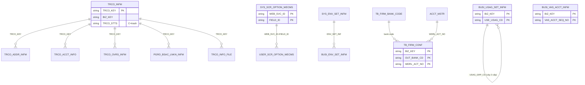
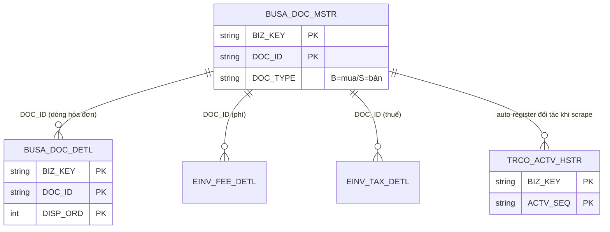
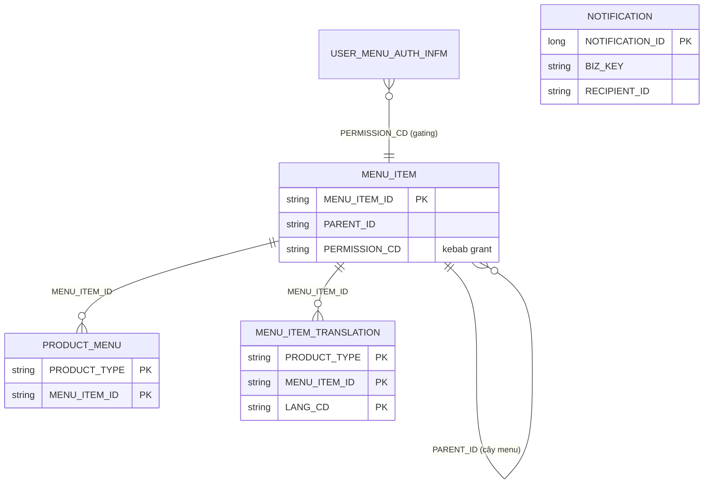
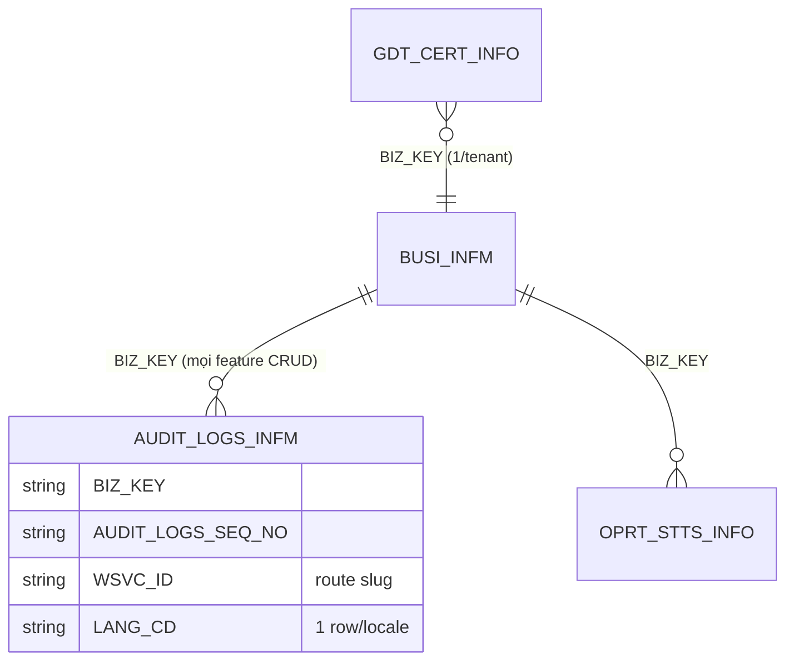

# 99 — ERD quan hệ bảng (theo cụm)

> Quan hệ logic suy ra từ code (entity/repository/service). Nhiều bảng legacy JEX **không có FK vật lý** ở DB — quan hệ dưới đây là quan hệ nghiệp vụ (qua `BIZ_KEY` + khóa nghiệp vụ). Mọi bảng tenant-scoped đều mang `BIZ_KEY`.

## 1. Cụm AUTH / USER / TENANT

- `BUSI_ADMN_INFM` quyết định ADMIN/USER cho cặp (BIZ_KEY, USER_ID). `USER_BUSI_CONN_INFM` là link user↔company (multi-company exceptional).

## 2. Cụm BANKING (account / transaction / scraping)

- `ACCT_AUTH_INFO` (entity từ V245): cờ quyền inquiry/transfer per-account, khóa nghiệp vụ trùng `ACCT_MSTR` (BANK_CD+ACCT_NO).
- Scraping audit: `EXT_TRAN_CALL_HIS`, `NXSIAS_MODULE_TRAN_LOG_HIS` (standalone, scope BIZ_KEY+USER_ID).

## 3. Cụm PAYMENT (scheduled / approval / dispatch)

- 4 module thanh toán chia sẻ `SCDUL_PYMN_SUMR(_DETL)` qua `SCDUL_PYMN_TYPE_CD`. Workflow phê duyệt tập trung `EXPT_RESOL_MSTR`/`_APPRVR_INFM`; dispatch: VND→`TB_PAY_TARGET`, non-VND/overseas→`TB_PAY_FILE_MST/_DATA`.
- Cụm dispatch firm-banking (entity `domain/payment/dispatch`): `TB_FIRM_TRAN`, `TB_FIRM_FILE_MST/_DATA/_RSLT`, `TB_FIRM_BAT_API_TRAN`, `TB_BATCH_SCHEDULE_INFO/_DTL`; `SCDU_PYMN_SUMR_DETL_PAY_TARGET_CONN` (refactor-native) nối chi tiết lịch thanh toán ↔ `TB_PAY_TARGET`.
- Bảng cấp số nội bộ (refactor-native, không phải legacy): `INTERNAL_TRANSFER_KEY_SEQ`, `OVERSEAS_PAYMENT_KEY_SEQ` — sinh khóa per-tenant cho internal/overseas payment.

## 4. Cụm SETTINGS (contacts / config / reference)

- Reference data toàn cục (không tenant-scoped): `NATN_INFM` (quốc gia), `BANK_INFM`/`BANK_INFM_DETL`, `NAPAS_BANK_INFO`, `TB_FIRM_BANK_CODE`.
- View (read-only, không phải bảng): `V_FIRM_BANKING_SETTING`, `V_FIRM_BANKING_HISTORY`, `V_PURPOSE_IN_USE` — gộp dữ liệu cho list/export; entity map nhưng không sinh schema.

## 5. Cụm E-INVOICE (Add-on hóa đơn điện tử)

- `BUSA_DOC_MSTR` dùng chung cho cả e-Invoice (sales/expenses) và link card-transaction (cụm 3). `BUSA_DOC_DETL` (V240), `TRCO_ACTV_HSTR` (V241) là bảng mới của phase-2 detail-save; `TRCO_ACTV_HSTR` thuộc họ Contacts nhưng chỉ e-Invoice tiêu thụ.

## 6. Cụm NAVIGATION / NOTIFICATION (refactor-native)

- Catalogue menu (V242/V243) thay thế legacy `MENU_AUTH_ADMN_SYS`: `MENU_ITEM` (node + cây tự tham chiếu), `PRODUCT_MENU` (thành viên + thứ tự theo F/M/H), `MENU_ITEM_TRANSLATION` (nhãn theo product+ngôn ngữ). `PERMISSION_CD` giao với `USER_MENU_AUTH_INFM.MENU_AUTH_CD` để gating.
- `NOTIFICATION` (V238/V239): kho thông báo in-app thống nhất (refactor-native, KHÔNG port column-for-column legacy `BLTB_NOTI_*`); 1 row/người nhận (fan-out), `NOTIFICATION_ID` IDENTITY toàn cục, đọc/chưa đọc qua `READ_AT`. Text resolve bằng `MESSAGE_CODE` + `MESSAGE_PARAMS` ở frontend i18n.

## 7. Cross-cutting

- `AUDIT_LOGS_INFM`: 1 row/locale (EN/KO/VI/KM) chung `AUDIT_LOGS_SEQ_NO`; `WSVC_ID` = route slug (vd `chart-of-accounts`, không phải legacy WSVC id).
