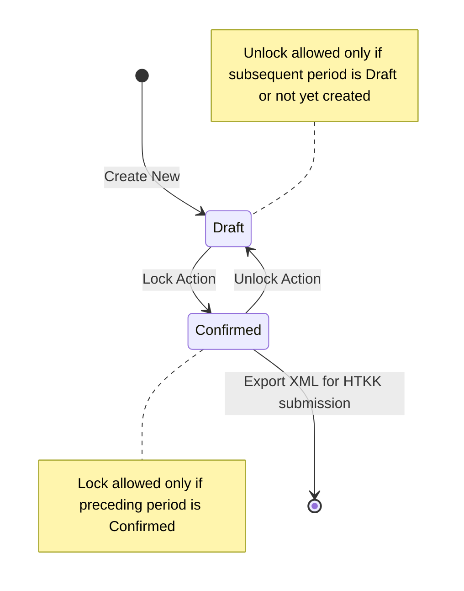

# Business Rules & Functional Specifications
## Project: VAT Declaration & 8% Tax Reduction Annex Module (WeCMS)

This document defines in detail the calculation formulas for tax indicators, status constraint matrices, and validation rules for inputs.

---

## 1. Indicator Calculation Formulas & Propagation

The WeCMS system automatically recalculates dependent indicators in real-time when inputs change. Below is the detailed formula matrix:

### 1.1 Input Propagation Rules
*   When editing **Purchase Value `[23]`**:
    *   Auto-calculate purchase VAT: `[24] = Math.floor([23] * 0.1)`
    *   Auto-assign deductible input VAT: `[25] = [24]`
*   When editing **Purchase VAT `[24]`**:
    *   Auto-assign deductible input VAT: `[25] = [24]`
*   When editing **5% Taxable Revenue `[30]`**:
    *   Auto-calculate 5% output VAT: `[31] = Math.floor([30] * 0.05)`
*   When editing **10% & 8% Taxable Revenue `[32]`**:
    *   Auto-calculate 10%/8% output VAT: `[33] = Math.floor([32] * 0.1)`

### 1.2 Formula Matrix for Auto-Calculated Indicators (Grey Cells)

| Code | Indicator Name (Vietnamese) | Calculation Formula | Type |
| :---: | :--- | :--- | :---: |
| **[22]** | Deductible VAT carried forward from previous period | Get indicator `[43]` of the preceding locked period's declaration | Automatic |
| **[27]** | Total revenue of taxable goods and services sold | `[27] = [29] + [30] + [32] + [32a]` | Automatic |
| **[28]** | Total output VAT | `[28] = [31] + [33] + [33a]` | Automatic |
| **[34]** | Total revenue of goods and services sold | `[34] = [26] + [27]` | Automatic |
| **[35]** | Total output VAT of goods and services sold | `[35] = [28]` | Automatic |
| **[36]** | Net VAT position | `[36] = [35] - [25]` | Automatic |
| **hieu_so** | Intermediate calculation net difference (`hieu_so`) | `hieu_so = [36] - [22] + [37] - [38] - [39a]` | Automatic |
| **[40a]** | VAT payable incurred in the period | If `hieu_so > 0`: `[40a] = hieu_so` Else: `[40a] = 0` | Automatic |
| **[40]** | Net VAT payable in the period | `[40] = Math.max(0, [40a] - [40b])` | Automatic |
| **[41]** | Un-deducted VAT carried forward | If `hieu_so < 0`: `[41] = Math.abs(hieu_so)` Else: `[41] = 0` | Automatic |
| **[43]** | VAT credit carried forward to next period | `[43] = Math.max(0, [41] - [42])` | Automatic |

---

## 2. Sequential Locking/Unlocking State Machine

To prevent corruption of the carry-forward deductible tax balance (where `[43]` of the previous period becomes `[22]` of the current period), WeCMS applies a sequential lock state machine:

### 2.1 Locking Rules (Lock):
*   When a user clicks the **Lock** button on a declaration for period `K`:
    *   The system checks the declaration of period `K-1` (e.g., the preceding period of Q2/2026 is Q1/2026; of May 2026 is April 2026).
    *   If period `K-1` exists and is in `Draft` status, or has not been created: The system blocks the lock request and prompts: *"You must lock the declaration of the preceding period before locking this one."*
    *   If period `K-1` is already locked (`Confirmed`) or period `K` is the first period: Allow status update of period `K` to `Confirmed`.

### 2.2 Unlocking Rules (Unlock):
*   When a user clicks the **Unlock** button on a declaration for period `K`:
    *   The system checks the declaration of period `K+1` (subsequent period).
    *   If period `K+1` exists and is in `Confirmed` status: The system blocks the unlock request and prompts: *"Cannot unlock this period because the subsequent tax period is already locked. Please unlock the subsequent period first."*
    *   If period `K+1` is in `Draft` status or not yet created: Allow unlocking period `K` to transition back to `Draft` for editing.

---

## 3. Data Input Validation Rules

Prior to saving or locking the declaration, the system performs validation checks on the following inputs:

| Field Name | Validation Rule | Error Message on Violation |
| :--- | :--- | :--- |
| **Signing Date** | Format `YYYY-MM-DD`. Cannot be empty. | *"Signing date cannot be empty and must be in the correct format."* |
| **Signatory Name** | String. Max 100 characters. | *"Signatory name is invalid (max 100 characters)."* |
| **Indicator Values** | All currency integer values must be $\ge 0$. Negative values are blocked. | *"Tax indicator values must be positive integers or zero."* |
| **Tax Agent Code** | Must be 10 or 13 digits (if tax agent information is provided). | *"Tax agent code is not in the correct format."* |
