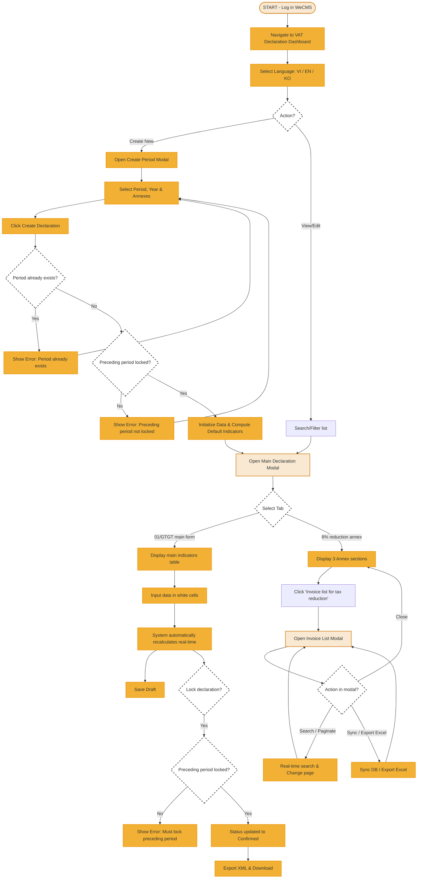

# Business Flow & User Flow Specification
## Project: VAT Declaration & 8% Tax Reduction Annex Module (WeCMS)

This document specifies the user flow, screen transitions, and business logic interactions within the VAT Declaration module.

---

## 1. Business Logic Flow Chart

Below is the detailed flow chart of user interactions from the Dashboard to the successful XML export:

---

## 2. Detailed Steps of the User Journey

### Step 1: Navigation & Language Selection (Dashboard)
*   The user accesses the **VAT Declaration** item on the system menu.
*   **Localization experience:** The system instantly displays in the language saved in the session config or by default. If the user selects a different language (English / 한국어), the entire static text on the UI changes instantly.

### Step 2: Create a new declaration period (Create Period)
*   The user clicks **"+ Create Declaration"**.
*   A modal appears prompting the user to select:
    1.  Tax Period (Month or Quarter).
    2.  Period Value (Month 1-12 or Quarter 1-4).
    3.  Tax Year (Default is current year).
    4.  Checkboxes for associated annexes.
*   **Constraint checks:** The system only allows creation when the period doesn't overlap with an existing one, and the preceding period is in **Confirmed (Locked)** status.

### Step 3: View & Enter indicators (Main Declaration Modal)
*   When the declaration modal opens, the user lands on the **01/GTGT Main Form** tab.
*   The user checks the values automatically aggregated from raw invoices.
*   If adjustments are needed, the user clicks on the editable input fields (colored white).
*   **Real-time calculations:** As soon as focus leaves the input field or Enter is pressed, all dependent indicators (colored grey) automatically update based on the formulas.

### Step 4: Annex interaction & Invoice details modal
*   On the **8% VAT Reduction Annex** tab, the user views the summary table.
*   The user can right-click on any row in the annex table to:
    *   **Add row:** Add a blank row to manually record an external invoice eligible for tax reduction.
    *   **Delete row:** Remove the selected invoice row from the annex.
*   To view the original invoices forming these numbers, the user clicks **"Invoice list for tax reduction"**.
*   The invoice modal opens, letting the user:
    *   Collapse/expand invoice groups by product name to verify totals.
    *   Enter search keywords (Invoice number, symbol, date...) to find specific invoices.
    *   Click **"Export Excel"** to hand over the details to auditors.

### Step 5: Lock & Export XML
*   The user clicks **"Lock"** to confirm the numbers. The declaration changes from Draft to Confirmed, locking all inputs.
*   The user clicks **"Export XML"**. The XML file is downloaded, named in accordance with the 13-digit tax code and period formatting rules to be imported directly into the GDT's HTKK software.
