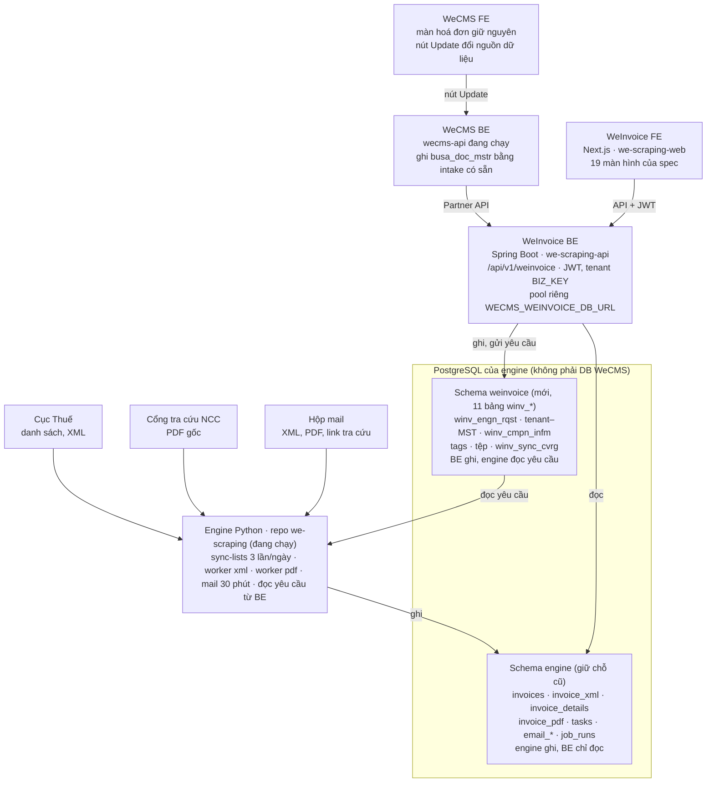

# API và dữ liệu WeInvoice

02/11/2026 · The Lai

## Kết luận

Dùng được. we-scraping-api và we-scraping-web là bản sao WeCMS, đúng bộ công nghệ UI spec đã chọn, và đã có sẵn một phần việc hoá đơn. Cần giữ 4 điều kiện bên dưới để không phá phần engine đang chạy.

|                      | we-scraping-api (BE)                                                                                                                      | we-scraping-web (FE)                                                                              |
| -------------------- | ----------------------------------------------------------------------------------------------------------------------------------------- | ------------------------------------------------------------------------------------------------- |
| Thực chất            | wecms-api (`com.kosign.wecms`)                                                                                                            | wecms-web                                                                                         |
| Công nghệ            | Spring Boot 3.5.13, Java 21, JPA, PostgreSQL, đóng gói WAR                                                                                | Next.js 16.2.3, React 19.2.4, Tailwind 4, axios, zod                                              |
| Khớp spec            | `lib/types.ts` của spec ghi sẵn API tương lai là Spring Boot, wire snake_case theo WeCMS                                                  | Spec viết bằng Next 16, React 19, Tailwind 4: chép component sang được                            |
| Dùng lại được        | JWT + tenant `BIZ_KEY`, quyền menu, i18n VI/EN/KO/KM, xuất Excel (POI), ShedLock, bảng `GDT_CERT_INFO` lưu tài khoản Cục Thuế theo tenant | Đăng nhập, khung app, màn `addon/sales-einvoices`, `addon/expenses-einvoices`, `addon/tax-filing` |
| Phần hoá đơn hiện có | `/api/v1/addon/einvoices` (danh sách, chi tiết, xuất, lịch sử), `/api/v1/addon/vat-declarations`                                          | Nút Update chạy engine Coocon NXiSAS trong trình duyệt rồi đẩy kết quả về BE                      |

Điều kiện:

1. Engine Python vẫn là nơi lấy dữ liệu và giữ bảng của nó. BE đọc các bảng đó, không chép sang `BUSA_DOC_MSTR`. Bảng này không có XML, PDF, hộp chờ; chỉ nhận tiền tệ VND, USD, 999, 998 (3 HĐ KRW sẽ lỗi CHECK); và bỏ qua HĐ có "kết quả kiểm tra" ngoài 6 câu đã biết.
2. Bảng engine nằm ở một schema riêng trong cùng PostgreSQL (`InvoiceStore` đã nhận tham số schema). Schema do DBA chạy tay, BE map entity với `ddl-auto: validate`, đúng quy định của wecms-api.
3. BE nhờ engine làm việc (đồng bộ, lấy XML, lấy PDF, đăng nhập thử, quét mail, đọc tệp tải lên) qua một bảng yêu cầu mà worker engine đọc. Không gọi thẳng Python, không dựng thêm server Python.
4. Chốt ranh giới sản phẩm. Spec ghi WeInvoice là phần mềm độc lập, WeCMS chỉ đổi nguồn dữ liệu cho nút Update. Hai repo đang mang nguyên banking, payment, tờ khai của WeCMS: tách thành sản phẩm riêng (tắt module không dùng) hay gắn thêm vào WeCMS là việc PO quyết.

## Đã triển khai (02/11/2026)

API P1 đã viết trong `we-invoice/we-scraping-api`, module `domain/weinvoice`: 40 endpoint `/api/v1/weinvoice` + 2 endpoint Partner API, 84 unit test qua. Chưa commit, chưa lên SIT: 05/11 đã chuyển sang nhánh `f1_v1_weinvoice_api` tách từ `origin/sit`, chờ commit tay. Hợp đồng chi tiết: `docs/features/addon-service/weinvoice/interface-specification.md` (trong repo đó). Khác so với bản đề xuất dưới đây:

| Điểm                   | Đề xuất ban đầu                            | Đã làm                                                                                                                                       |
| ---------------------- | ------------------------------------------ | -------------------------------------------------------------------------------------------------------------------------------------------- |
| Nơi đặt bảng WeInvoice | Schema mới trong cùng PostgreSQL với WeCMS | Trong **DB của engine**, schema `weinvoice`; BE mở kết nối riêng (`WECMS_WEINVOICE_DB_URL`), không đụng DB WeCMS (DB này dùng chung với JEX) |
| Bảng engine            | Chuyển sang schema riêng                   | Giữ nguyên chỗ cũ; BE chỉ đọc, tên schema cấu hình được (`WECMS_WEINVOICE_ENGINE_SCHEMA`)                                                    |
| Mật khẩu Cục Thuế      | `GDT_CERT_INFO` hoặc bảng mới              | Bảng `winv_cmpn_infm`, AES-256-GCM, khoá `WECMS_WEINVOICE_SECRET_KEY` (engine giải mã bằng `AESGCM`)                                         |
| Xác thực Partner API   | Chưa chốt                                  | Header `X-Api-Key`, danh sách khoá trong `WECMS_WEINVOICE_PARTNER_API_KEYS`                                                                  |
| Đóng gói ZIP           | `request_id` rồi `GET /exports/{id}/file`  | Trả thẳng ZIP trong `POST /invoices/export/zip`                                                                                              |
| Top đối tác            | `GET /dashboard/top-partners`              | Nằm trong `GET /dashboard`                                                                                                                   |

Còn thiếu để chạy được: DBA chạy 3 script (`db/weinvoice/V1__winv_schema.sql`, script cấp quyền, script seed 144 NCC); và engine cần một worker đọc bảng `weinvoice.winv_engn_rqst`. Chưa có worker này thì mọi việc nhờ engine (đăng nhập thử, đồng bộ, lấy XML/PDF, nhập tệp) đều nằm ở `queued`.

## Kiến trúc đã làm

Engine giữ nguyên việc lấy dữ liệu và bảng của nó. Bảng WeInvoice nằm trong cùng DB với engine, ở schema `weinvoice`. BE mở kết nối riêng tới DB này và không đụng DB WeCMS (DB đó dùng chung với JEX). WeInvoice BE đọc bảng engine, ghi bảng của mình và bảng yêu cầu. WeCMS gọi Partner API thay cho engine Coocon chạy trong trình duyệt.

## DB còn thiếu cho Partner API (nút Update của WeCMS)

Engine đã có 39/48 trường WeCMS cần. 4 trường có nhưng phải đổi mã hoặc định dạng, 5 trường không có trong dữ liệu Cục Thuế. Nguồn: 2 DTO `ScrapedEInvoiceRow` (đầu HĐ) và `ScrapedEInvoiceDetailRow` (chi tiết) mà WeCMS đang nhận từ engine Coocon qua `POST /api/v1/addon/einvoices/scrape-results` và `/scrape-detail-results`. Partner API trả đúng 2 hình dạng này thì WeCMS giữ nguyên code ghi `BUSA_DOC_MSTR`.

| Trường WeCMS                                                        | Lấy từ DB engine                                                                                                                                  | Tình trạng                                                                                                         |
| ------------------------------------------------------------------- | ------------------------------------------------------------------------------------------------------------------------------------------------- | ------------------------------------------------------------------------------------------------------------------ |
| `invoiceStatus` (chữ: "Hóa đơn đã bị hủy"…)                         | `invoices.tthai` (mã 1–6) → đổi sang chữ; HĐ lấy từ Excel còn chữ gốc ở `list_raw._tthai_text`                                                    | Đổi mã. 19 HĐ đang NULL                                                                                            |
| `checkResult` (chữ: "Đã cấp mã hóa đơn"…)                           | `list_raw._ttxly_text` (Excel) hoặc `list_raw.ttxly` (JSON, chỉ có mã)                                                                            | Đổi mã. WeCMS bỏ qua HĐ có câu ngoài 6 câu đã biết, nên phải ra đúng chữ                                           |
| `currencyCd`                                                        | `list_raw.dvtte`, `parsed.thong_tin_chung.don_vi_tt`                                                                                              | Có, nhưng CHECK của `BUSA_DOC_MSTR` chỉ nhận VND, USD, 999, 998                                                    |
| `originalInvoice`                                                   | `parsed.thong_tin_chung.hoa_don_lien_quan` (mẫu, ký hiệu, số, ngày)                                                                               | Có, cần chốt chuỗi ghép giống Coocon                                                                               |
| `invoiceInfo`                                                       | —                                                                                                                                                 | Thiếu. Riêng của Coocon; WeCMS chỉ lưu, không hiển thị → gửi rỗng                                                  |
| `buyerSignBy`, `sellerSignBy`                                       | —                                                                                                                                                 | Thiếu. Tên người ký nằm trong chứng thư số (`DSCKS`); `xml_parser` mới lấy thời điểm ký                            |
| `sellerRpprEnm`, `sellerPicName`                                    | —                                                                                                                                                 | Thiếu. Coocon tra thêm đăng ký thuế; WeCMS dùng để tự tạo đối tác (`EInvoiceTrcoAutoRegistrar`), để trống vẫn chạy |
| `numericSymbol`, `invoiceSymbol`, `invoiceNo`, `sellerTaxCode`      | `khmshdon`, `khhdon`, `shdon`, `nbmst`                                                                                                            | Có. `DOC_ID` WeCMS = mẫu + ký hiệu + "-" + số (+ "-" + MST bán với HĐ mua), khớp 1-1 khoá engine                   |
| `invoiceDate` (yyyyMMdd)                                            | `ngay_lap` (đã là giờ VN)                                                                                                                         | Có                                                                                                                 |
| `totalAmt`, `totalAmtWithoutTax`, `totalTaxAmt`                     | `tong_tien`, `tien_chua_thue`, `tien_thue`                                                                                                        | Có                                                                                                                 |
| `totalDiscount`, `totalFee`                                         | `list_raw.ttcktmai`, `list_raw.tgtphi`, `parsed.thanh_toan`                                                                                       | Có, chỉ trong JSONB                                                                                                |
| `einvTestResults` ('' C, '1' K, '2' MTT)                            | Suy từ `khhdon` (ký tự đầu, ký tự thứ 4) hoặc `sub_type`                                                                                          | Có                                                                                                                 |
| `trcoCmnm`, `trcoName`, `sellerName`, `buyerName`, `buyerTaxCode`   | `nbten`, `nmten`, `nmmst`                                                                                                                         | Có                                                                                                                 |
| `invoiceTitle`, `paymentType`, `rate`, `mccqt`                      | `parsed`: `loai_hd`, `hinh_thuc_tt`, `ty_gia`, `ma_cqt`                                                                                           | Có                                                                                                                 |
| Địa chỉ, điện thoại, tài khoản và ngân hàng 2 bên, `buyerCitizenId` | `parsed.nguoi_ban`, `parsed.nguoi_mua` (`cccd`), `partners`                                                                                       | Có khi có XML                                                                                                      |
| `listNumber`, `listDate`, `totalAmtInLetter`, `qrCode`              | `parsed`: `so_bang_ke`, `ngay_bang_ke`, `thanh_toan.bang_chu`, `qr.raw`                                                                           | Có khi XML có                                                                                                      |
| `buyerSignDate/Time`, `sellerSignDate/Time`                         | `parsed.ky_so` (SigningTime)                                                                                                                      | Có, tách ngày và giờ                                                                                               |
| `products[]`                                                        | `invoice_details`: `ten_hhdv` → cả `product` (ITEM_NM) và `productName`; `don_vi_tinh`, `don_gia`, `so_luong`, `thanh_tien`, `thue_suat`, `st_ck` | Có                                                                                                                 |
| `fees[]`, `taxes[]`                                                 | `parsed.thanh_toan.phi`, `parsed.thanh_toan.theo_thue_suat`                                                                                       | Có, chỉ trong JSONB                                                                                                |

HĐ chưa có XML (553 HĐ không mã đo ngày 02/11) chỉ gửi được phần đầu HĐ. Trước khi WeCMS gọi được, mỗi MST của WeCMS (`BUSI_INFM.TAX_ID`) phải có trong `companies` của engine kèm tài khoản Cục Thuế.

## DB còn thiếu cho các màn WeInvoice và xử lý phía BE

Có 16 chỗ thiếu cho P1. 4 chỗ đầu chặn cả kiến trúc, nên làm trước: nối tenant với MST, tài khoản Cục Thuế, bảng yêu cầu BE → engine, và tiền quy đổi VND. Tên bảng dưới đây là đề xuất, Dev đặt lại theo quy ước wecms-api.

| Thiếu                                                                                                                       | Dùng cho                                                         | Đề xuất                                                                                                                 | Ưu tiên           |
| --------------------------------------------------------------------------------------------------------------------------- | ---------------------------------------------------------------- | ----------------------------------------------------------------------------------------------------------------------- | ----------------- |
| Nối tenant `BIZ_KEY` với MST. Một tài khoản quản lý tối đa 5 MST; engine chỉ có `companies`                                 | Mọi API lọc theo MST làm việc, màn 02, 06                        | Bảng tenant–MST: nhãn, trạng thái kết nối, MST mặc định                                                                 | P1                |
| Tài khoản Cục Thuế trong DB. Mật khẩu đang ở `.env`, tên đăng nhập có thể khác MST (`1201496252-U002`)                      | Màn 06, Partner API                                              | Dùng `GDT_CERT_INFO` của WeCMS hoặc bảng mới, mã hoá; engine đọc được                                                   | P1                |
| Yêu cầu từ BE tới engine                                                                                                    | Màn 05, 06, 08, 09, 10                                           | `engine_requests`: loại (sync, fetch_xml, fetch_pdf, login_test, mail_scan, import), tham số, trạng thái, bước, kết quả | P1                |
| Tiền quy đổi VND. `tong_tien` theo đơn vị tiền của HĐ, `don_vi_tt`, `ty_gia` chỉ trong JSONB                                | KPI màn 03, 04, tờ khai: cộng thẳng 11 HĐ USD và 3 HĐ KRW là sai | Cột `currency`, `exchange_rate` và 3 cột tiền quy VND                                                                   | P1                |
| Kết quả kiểm tra `ttxly` chỉ trong `list_raw`                                                                               | Partner API, lọc loại HĐ                                         | Cột mã + chữ gốc                                                                                                        | P1                |
| Cập nhật trạng thái HĐ đã có: `upsert_invoices` đang `DO NOTHING`                                                           | Nhãn màn 04, số "cập nhật" màn 10, "HĐ biến động" màn 13         | Cập nhật `tthai`, `list_raw` + bảng lịch sử trạng thái                                                                  | P1                |
| 19 HĐ "Hóa đơn đã bị xóa bỏ/hủy bỏ" có `tthai` NULL                                                                         | KPI bỏ HĐ huỷ, Partner API                                       | Thêm nhãn vào `invoice_list_excel._TTHAI`, sửa 19 dòng                                                                  | P1                |
| Thuế theo từng thuế suất chỉ trong `parsed.thanh_toan`                                                                      | Partner API `taxes[]`, tờ khai, thuế suất bất thường             | Bảng hoặc view `invoice_tax_rates`                                                                                      | P1                |
| Tạo HĐ từ XML: `list_raw`, `sub_type` NOT NULL; `invoice_details.nguon` chỉ nhận xml, xml_email, pdf; không có cột nguồn HĐ | Màn 07 ("Tạo mới"), 09, 15; 903 XML mail đang chờ                | Nới ràng buộc, thêm `xml_upload` và cột nguồn (gdt, email, upload)                                                      | P1                |
| Tệp đính kèm, tệp tải lên, lịch sử thay PDF                                                                                 | Màn 05, 09                                                       | `invoice_files`: loại, nguồn, người nạp, lúc nạp, "vẫn đính kèm"                                                        | P1                |
| Mã tra cứu nhập tay                                                                                                         | Màn 04 (pill "!"), 05                                            | Cột hoặc bảng: mã, mã công ty, người nhập; ưu tiên hơn mã đoán từ XML                                                   | P1                |
| Độ phủ đồng bộ theo (MST, loại, tháng)                                                                                      | Banner "kỳ chưa lấy đủ" màn 03, 04, 10                           | `sync_coverage`: số HĐ Cục Thuế báo, đã lấy, lúc lấy                                                                    | P1                |
| Lượt đồng bộ đủ trường                                                                                                      | Màn 10                                                           | Thêm vào `job_runs`: kỳ từ–đến, kích hoạt, số cập nhật, lý do, huỷ                                                      | P1                |
| Mail gắn MST: `email_messages` không biết thuộc MST nào                                                                     | Màn 07, khớp đúng phạm vi MST                                    | Cột MST + địa chỉ nhận riêng `hd-<mst>@…`                                                                               | P1                |
| Danh mục 144 NCC nằm trong code UI; `einvoice_providers.name` trống                                                         | Màn 04 "Phát hành qua", 16                                       | Bảng danh mục, nối `einvoice_providers.source_id`                                                                       | P1                |
| Tag                                                                                                                         | Màn 04, 18                                                       | `tags`, `invoice_tags`                                                                                                  | P1 (gắn, lọc: P2) |
| Liên kết HĐ thay thế với HĐ gốc chỉ trong `parsed`                                                                          | Màn 05 So sánh                                                   | Cột `related_invoice_id` tính lúc ghi                                                                                   | P2                |
| Quyền theo MST, 8 quyền, mẫu quyền (WeCMS mới có quyền menu)                                                                | Màn 18 tài khoản con                                             | Bảng quyền user–MST                                                                                                     | P2                |
| Đánh dấu HĐ đã vào tờ khai (WeCMS có `vat_decl_proc_yn`, `vat_decl_sid` trên `BUSA_DOC_MSTR`)                               | Kê khai GTGT                                                     | Bảng phụ theo HĐ                                                                                                        | P4                |
| Đăng ký thuế đối tác, tên người ký trong chứng thư số                                                                       | Màn 13, 14, 17                                                   | Bảng cache đăng ký thuế; parse thêm `DSCKS`                                                                             | P3–P5             |

Ngoài ra còn 28 tệp mail `unmatched` đã mất tệp tạm: `rematch` bỏ qua im lặng, cần đánh trạng thái riêng.

## Quy ước API

Theo quy ước sẵn có của wecms-api (README, mục API Conventions), thêm 3 điểm riêng cho WeInvoice.

- **Đường dẫn:** `/api/v1/weinvoice/...` cho app WeInvoice, tránh trùng `/api/v1/addon/einvoices` của WeCMS khi chung codebase. Partner API riêng ở `/api/partner/v1/...`, xác thực máy–máy. Bảng dưới viết tắt `/api/v1/weinvoice` thành `/`.
- **Phản hồi:** `{ status: { error, code, message }, data }`; xem `status.error`, không xem HTTP code. Tệp tải về trả thẳng kèm `Content-Disposition`. Mã lỗi `WBExxxx` theo `Accept-Language` (VI, EN, KO).
- **Tên trường:** snake_case trên dây; `page` (từ 0) + `size`; `sort_field` + `sort_direction` qua enum whitelist. Endpoint cũ của WeCMS còn `sortField` camelCase, endpoint mới dùng snake_case.
- **Tenant và MST làm việc:** tenant lấy từ JWT, không nhận từ request. MST làm việc gửi bằng `company_mst` ở từng request; BE kiểm MST thuộc tenant và người dùng có quyền.
- **Ngày:** `yyyy-MM-dd` cho API WeInvoice (giống spec); `yyyyMMdd` cho Partner API (giống intake WeCMS).
- **Việc engine làm** (đồng bộ, lấy XML, lấy PDF, đăng nhập thử, quét mail, đọc tệp tải lên): API trả `request_id` ngay, FE hỏi lại `GET /requests/{request_id}`. Cột "Engine" ở bảng dưới đánh dấu các API này.

## API theo màn hình

Mỗi màn của spec có một nhóm API; màn 19 (lộ trình) không cần API. Đường dẫn viết tắt, bỏ tiền tố `/api/v1/weinvoice`. Phase ghi trong ngoặc khi khác P1, theo Function List v1.0.

### Chung · 01 Đăng nhập · 02 Khung app

| Method | Đường dẫn                | Việc                                                                                 | Engine |
| ------ | ------------------------ | ------------------------------------------------------------------------------------ | ------ |
| POST   | `/api/v1/auth/login`     | Đăng nhập, trả JWT (có sẵn trong WeCMS)                                              |        |
| POST   | `/api/v1/auth/logout`    | Đăng xuất (có sẵn)                                                                   |        |
| GET    | `/me`                    | Người dùng, ngôn ngữ, MST được phép (nhãn, trạng thái), quyền, MST làm việc gần nhất |        |
| PUT    | `/me/preferences`        | Lưu ngôn ngữ, MST làm việc mặc định, phím tắt                                        |        |
| GET    | `/requests/{request_id}` | Tiến trình việc engine đang làm: bước, kết quả, lỗi                                  |        |
| GET    | `/search`                | Ctrl+K: trang, HĐ, đối tác trong MST làm việc (P3)                                   |        |
| GET    | `/notifications`         | Chuông thông báo (P3)                                                                |        |

### 03 Tổng quan

| Method | Đường dẫn                                    | Việc                                                                                                                                                                               | Engine |
| ------ | -------------------------------------------- | ---------------------------------------------------------------------------------------------------------------------------------------------------------------------------------- | ------ |
| GET    | `/dashboard?company_mst=&year=`              | 4 KPI (bỏ HĐ huỷ và bị thay thế, tiền quy VND), 12 tháng bán/mua, tình trạng dữ liệu (có mã thiếu XML, không mã chưa XML, chưa PDF, tháng chưa đủ got/total), lần đồng bộ gần nhất, top 5 đối tác mua vào theo tổng tiền (không có endpoint `/dashboard/top-partners` riêng) |        |

Nút Đồng bộ ở màn này, màn 04 và màn 06 đều gọi `POST /sync-runs` (màn 10).

### 04 Hoá đơn mua vào / bán ra

| Method | Đường dẫn                     | Việc                                                                                                                                                                                                                                                                                      | Engine |
| ------ | ----------------------------- | ----------------------------------------------------------------------------------------------------------------------------------------------------------------------------------------------------------------------------------------------------------------------------------------- | ------ |
| GET    | `/invoices`                   | Danh sách. Lọc `company_mst`, `direction`, `from`, `to`, `keyword`, `xml` và `pdf` (has, missing), `statuses`, `kind` (normal, cash_register, no_code), `tag_ids`, `provider` (MST NCC, `no_code`, `unknown`), `exclude_tax_ids`. Trả `rows`, `total_count`, `kpis`, `incomplete_periods` |        |
| GET    | `/invoices/facets`            | Số HĐ theo NCC, trạng thái, loại trong kỳ, để dựng bộ lọc "Phát hành qua"                                                                                                                                                                                                                 |        |
| GET    | `/invoices/ids`               | Mọi id khớp bộ lọc, cho "chọn tất cả"                                                                                                                                                                                                                                                     |        |
| POST   | `/invoices/fetch-missing-xml` | Body `ids` → đưa task xml lên đầu hàng đợi; trả `queued`, `skipped_no_code`                                                                                                                                                                                                               | Có     |
| POST   | `/invoices/export/excel`      | Body bộ lọc hoặc `ids` → tệp .xlsx. FE hỏi "Lấy XML còn thiếu" trước khi `kpis.missing_xml` > 0 (quy tắc 3.6)                                                                                                                                                                             |        |
| POST   | `/invoices/export/zip`        | Body `ids`, `mode` (flat, by_month, by_partner, by_month_partner, per_invoice), `include` (xml, pdf, rendered, summary) → trả thẳng tệp ZIP (`Content-Disposition`), không qua `request_id` / `GET /exports/{id}/file`                                                                   |        |
| PUT    | `/invoices/tags`              | Body `ids`, `tag_id`, `on` → gắn hoặc bỏ tag hàng loạt (P2)                                                                                                                                                                                                                               |        |

### 05 Chi tiết hoá đơn

| Method | Đường dẫn                        | Việc                                                                                                                                                                                                                                  | Engine |
| ------ | -------------------------------- | ------------------------------------------------------------------------------------------------------------------------------------------------------------------------------------------------------------------------------------- | ------ |
| GET    | `/invoices/{id}`                 | Đủ trường `Invoice` của spec: 2 bên, tiền, tiền tệ, tỷ giá, trạng thái, `related_id`, mã CQT, NCC, `lookup` (mã, mã công ty, link, mở thẳng hay không), dòng hàng, thuế theo thuế suất, phí, thời điểm ký, trạng thái task xml và pdf |        |
| GET    | `/invoices/{id}/files`           | Hồ sơ tệp: loại, tên, nguồn, thời điểm, có được xoá không                                                                                                                                                                             |        |
| GET    | `/invoices/{id}/files/{file_id}` | Tải 1 tệp (XML, PDF, đính kèm)                                                                                                                                                                                                        |        |
| POST   | `/invoices/{id}/files`           | Multipart `kind`, `file`, `confirm` (attach_anyway, replace) → `ok`, hoặc `needs_confirm` kèm lý do (không thấy số HĐ, khoá XML khác, đã có PDF)                                                                                      |        |
| DELETE | `/invoices/{id}/files/{file_id}` | Xoá tệp tải lên hoặc từ email; tệp từ Cục Thuế, NCC thì từ chối                                                                                                                                                                       |        |
| POST   | `/invoices/{id}/original-pdf`    | Lấy PDF gốc ngay → `request_id`; các bước: mở cổng, gửi mã, tải PDF                                                                                                                                                                   | Có     |
| PUT    | `/invoices/{id}/lookup-code`     | Body `code` (mã hoặc nguyên link), `company_code` → lưu, chạy lại task pdf                                                                                                                                                            | Có     |
| GET    | `/invoices/{id}/related`         | HĐ thay thế và bị thay thế cho tab So sánh (P2)                                                                                                                                                                                       |        |

### 06 Kết nối Cục Thuế

| Method | Đường dẫn                   | Việc                                                                                                                         | Engine |
| ------ | --------------------------- | ---------------------------------------------------------------------------------------------------------------------------- | ------ |
| GET    | `/companies`                | MST, tên DN, nhãn, tên đăng nhập, trạng thái (connected, expired, error), đồng bộ gần nhất; `quota` (đã dùng, tối đa)        |        |
| POST   | `/companies`                | Body `company_mst`, `gdt_username`, `password`, `label` → `request_id`: engine giải captcha, đăng nhập thử, đúng thì mới lưu | Có     |
| PUT    | `/companies/{mst}/password` | Đổi mật khẩu, đăng nhập thử lại                                                                                              | Có     |
| PATCH  | `/companies/{mst}`          | Sửa nhãn                                                                                                                     |        |
| DELETE | `/companies/{mst}`          | Xoá MST (giữ hay xoá HĐ đã lấy: PO chốt)                                                                                     |        |

### 10 Lịch sử đồng bộ · Đồng bộ hàng loạt

| Method | Đường dẫn                    | Việc                                                                                                                                                 | Engine |
| ------ | ---------------------------- | ---------------------------------------------------------------------------------------------------------------------------------------------------- | ------ |
| POST   | `/sync-runs`                 | Body `company_msts[]`, `direction` (both, purchase, sales), `from_month`, `to_month`, `trigger` (manual, bulk) → id các lượt, xếp hàng chạy lần lượt | Có     |
| GET    | `/sync-runs/{run_id}`        | Tiến trình: `step` (login, captcha, list, xml, done), tháng đang chạy, `listed`, `xml_done`, `xml_total`                                             |        |
| POST   | `/sync-runs/{run_id}/cancel` | Dừng lượt đang chạy                                                                                                                                  | Có     |
| GET    | `/sync-runs`                 | Lịch sử, lọc `company_mst`, `status`: kỳ, kích hoạt, HĐ mới, cập nhật, XML, thời gian, trạng thái, lý do                                             |        |

### 07 Hoá đơn từ email

| Method | Đường dẫn                     | Việc                                                                                                               | Engine |
| ------ | ----------------------------- | ------------------------------------------------------------------------------------------------------------------ | ------ |
| GET    | `/email/address?company_mst=` | Địa chỉ nhận riêng `hd-<mst>@…` của MST                                                                            |        |
| GET    | `/email/messages`             | Mail đã xử lý, lọc `company_mst`, `from`, `to`, `result`: lúc nhận, người gửi, tiêu đề, tệp, kết quả, HĐ liên quan |        |
| GET    | `/email/messages/{id}`        | Từng tệp, từng link trong mail và trạng thái                                                                       |        |

### 08 Kết nối email (P2)

| Method | Đường dẫn                      | Việc                                                             | Engine |
| ------ | ------------------------------ | ---------------------------------------------------------------- | ------ |
| GET    | `/mailboxes`                   | Hộp đã kết nối: địa chỉ, loại, lần quét gần nhất, số HĐ tìm thấy |        |
| POST   | `/mailboxes/gmail`             | Body `address`, `app_password` → đăng nhập IMAP thử, lưu bí mật  | Có     |
| GET    | `/mailboxes/outlook/authorize` | URL đăng nhập Microsoft (OAuth uỷ quyền người dùng)              |        |
| GET    | `/mailboxes/outlook/callback`  | Nhận mã OAuth, lưu token                                         |        |
| POST   | `/mailboxes/{id}/scan`         | Quét ngay → `request_id`                                         | Có     |
| DELETE | `/mailboxes/{id}`              | Ngắt kết nối, xoá bí mật                                         |        |

### 09 Tải lên · 15 Xem HĐ từ XML

| Method | Đường dẫn                    | Việc                                                                                                                               | Engine |
| ------ | ---------------------------- | ---------------------------------------------------------------------------------------------------------------------------------- | ------ |
| POST   | `/uploads`                   | Multipart `files[]`, `company_mst` → `upload_id`; engine đọc XML, ZIP, PDF và loại trùng theo 3.2                                  | Có     |
| GET    | `/uploads/{upload_id}`       | Kết quả từng tệp: `outcome` (new, merged, duplicate, foreign, error, pdf_pending), lỗi, HĐ, đối tác, tổng tiền, trạng thái PDF gốc |        |
| POST   | `/uploads/{upload_id}/adopt` | Body `company_mst` → thêm MST (chờ mật khẩu) rồi nhập các tệp của MST đó                                                           | Có     |
| DELETE | `/uploads/{upload_id}`       | Xoá kết quả                                                                                                                        |        |
| POST   | `/test-data/load`            | Nạp bộ TestData + kết quả mong đợi để nghiệm thu (M14; chỉ bật ở dev và SIT)                                                       | Có     |

Màn 15 không cần API riêng: FE đọc XML bằng `lib/xml.ts` có sẵn trong spec, nút "Thêm vào kho" gọi `POST /uploads`.

### 16 Danh mục NCC · 18 Cài đặt, tag, tài khoản con

| Method | Đường dẫn                   | Việc                                                                         | Engine |
| ------ | --------------------------- | ---------------------------------------------------------------------------- | ------ |
| GET    | `/providers`                | 144 NCC, lọc theo từ khoá và tình trạng link, kèm số HĐ đang dùng của tenant |        |
| GET    | `/tags`                     | Tag + số HĐ dùng                                                             |        |
| POST   | `/tags`                     | Tạo tag                                                                      |        |
| PATCH  | `/tags/{id}`                | Đổi tên, đổi màu                                                             |        |
| DELETE | `/tags/{id}`                | Xoá tag                                                                      |        |
| GET    | `/sub-accounts`             | Danh sách tài khoản con (P2)                                                 |        |
| POST   | `/sub-accounts`             | Tạo và gửi lời mời (P2)                                                      |        |
| PUT    | `/sub-accounts/{id}`        | Sửa MST được phép, 8 quyền (P2)                                              |        |
| PATCH  | `/sub-accounts/{id}/status` | Khoá hoặc mở (P2)                                                            |        |
| POST   | `/sub-accounts/{id}/invite` | Gửi lại lời mời (P2)                                                         |        |
| DELETE | `/sub-accounts/{id}`        | Xoá tài khoản con (P2)                                                       |        |

### Sau P1 · 11, 12, 13, 14, 17

| Method            | Đường dẫn                                                 | Việc                                                           | Engine          |
| ----------------- | --------------------------------------------------------- | -------------------------------------------------------------- | --------------- |
| GET               | `/checks/review`                                          | 3 mục rà soát theo kỳ (P3)                                     |                 |
| POST              | `/checks/partner-validity`                                | Đối chiếu đối tác với đăng ký thuế → `request_id` (P3)         | Chưa chốt nguồn |
| GET               | `/supplier-risk`                                          | Bảng rủi ro NCC + chip lọc (P5)                                |                 |
| GET               | `/supplier-risk/{partner_mst}`                            | Panel chi tiết 1 đối tác (P5)                                  |                 |
| POST              | `/supplier-risk/tax-rate-scan`                            | Quét thuế suất bất thường (P5)                                 |                 |
| POST              | `/taxpayer-lookups`                                       | Tra tối đa 100 MST (P5)                                        | Chưa chốt nguồn |
| PUT               | `/taxpayer-lookups/{tax_id}`                              | Ghi kết quả người dùng tự xác nhận (P5)                        |                 |
| GET, POST, DELETE | `/journal-rules`                                          | Quy tắc định khoản (P5)                                        |                 |
| POST              | `/journal/propose`                                        | Lập định khoản theo kỳ, TT200 hoặc TT133 (P5)                  |                 |
| POST              | `/journal/export`                                         | Xuất Excel định khoản (P5)                                     |                 |
| POST              | `/tax-portal/connections`                                 | Kết nối cổng thuế điện tử, mã xác nhận người dùng tự nhập (P6) | Chưa chốt       |
| GET               | `/tax-portal/{mst}/returns`, `/payment-slips`, `/notices` | 3 tab của màn Tờ khai đã nộp (P6)                              |                 |

### Partner API cho WeCMS (P1 Must)

Tiền tố `/api/partner/v1`, WeCMS BE gọi máy–máy. Kết quả đúng hình dạng 2 DTO WeCMS đang nhận, snake_case.

| Method | Đường dẫn                                        | Việc                                                                                                                                                                        | Engine |
| ------ | ------------------------------------------------ | --------------------------------------------------------------------------------------------------------------------------------------------------------------------------- | ------ |
| GET    | `/einvoices?tax_id=&type=&from=&to=&page=&size=` | `type` SALES hoặc EXPENSE → hàng `ScrapedEInvoiceRow`. EXPENSE gộp 3 nhóm C, K, MTT với `einv_test_results` '', '1', '2'                                                    |        |
| POST   | `/einvoices/details`                             | Body `tax_id`, `type`, danh sách khoá HĐ (`numeric_symbol`, `invoice_symbol`, `invoice_no`, `seller_tax_code`) → `ScrapedEInvoiceDetailRow` kèm `products`, `fees`, `taxes` |        |

Phía WeCMS chỉ thêm 1 endpoint BE (vd `POST /api/v1/addon/einvoices/sync`) gọi 2 API trên, rồi dùng lại `EInvoiceScrapeService` và `EInvoiceDetailScrapeService`. Nút Update không cần engine Coocon trong trình duyệt nữa.

## Việc cần chốt

8 quyết định chặn việc chia task BE. Dev đã chốt 3 cái khi viết code (02/11); 5 cái còn lại chờ PO.

- [ ] **Ranh giới sản phẩm:** WeInvoice tách riêng từ bản sao WeCMS, hay thêm module vào WeCMS (PO).
- [x] **BE nhờ engine làm việc:** bảng yêu cầu `weinvoice.winv_engn_rqst`, worker engine đọc (Dev). Worker phía engine chưa viết.
- [ ] **Tệp gốc:** BE đọc thẳng thư mục `output/` của engine (cùng máy hoặc ổ dùng chung), hay engine đẩy tệp lên kho tệp chung (Dev). Tải XML, PDF và đóng gói ZIP đều cần. Code hiện đọc `WECMS_WEINVOICE_ENGINE_OUTPUT_DIR`, nên cần cùng máy hoặc ổ dùng chung.
- [x] **Mật khẩu Cục Thuế:** bảng mới `winv_cmpn_infm`, AES-256-GCM, khoá `WECMS_WEINVOICE_SECRET_KEY`; engine giải mã bằng `AESGCM` với cùng khoá (Dev).
- [ ] **Form Thêm MST:** thêm ô tên đăng nhập Cục Thuế, vì tài khoản có thể khác MST (PO).
- [ ] **Partner API:** WeCMS xử lý HĐ ngoại tệ ngoài VND, USD thế nào với CHECK của `BUSA_DOC_MSTR` (PO, team WeCMS). Phần xác thực máy–máy đã chốt: header `X-Api-Key`, danh sách khoá trong `WECMS_WEINVOICE_PARTNER_API_KEYS` (Dev).
- [ ] **Quy tắc 3.4:** bật hay không 13 adapter đang tự đọc captcha ảnh ở cổng NCC (PO).
- [ ] **Xoá MST:** giữ hay xoá HĐ đã lấy của MST đó (PO).
