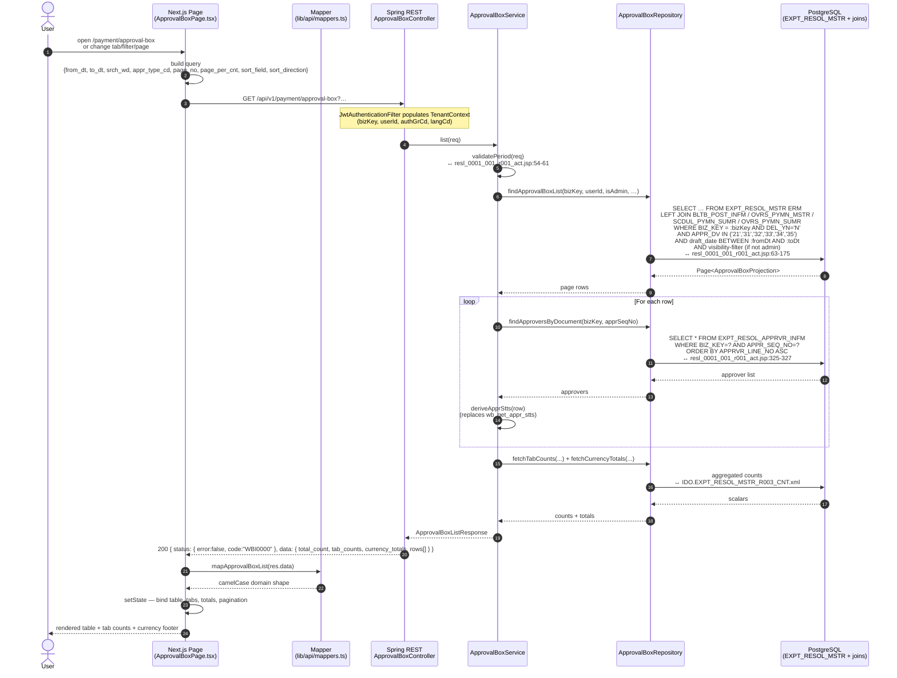
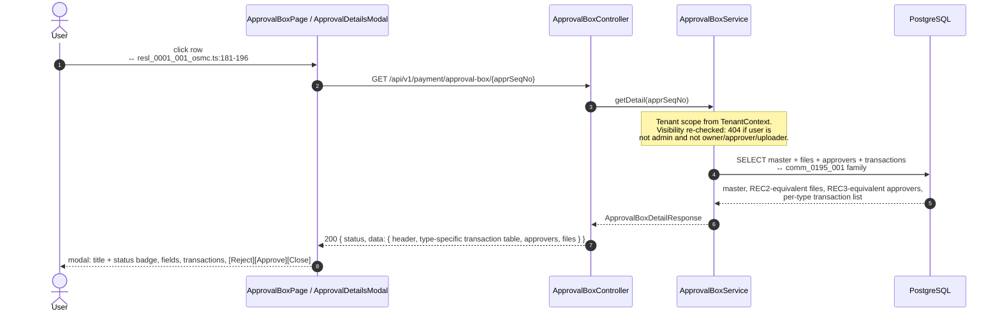
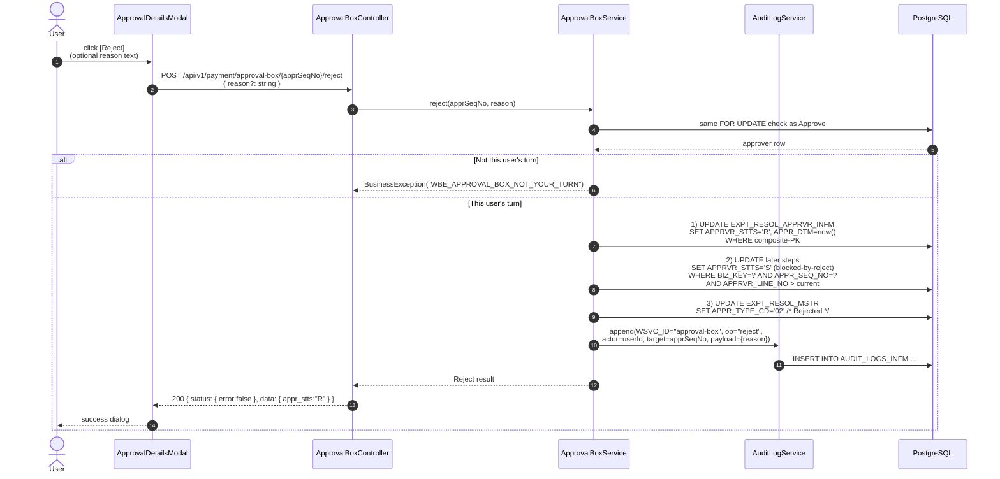
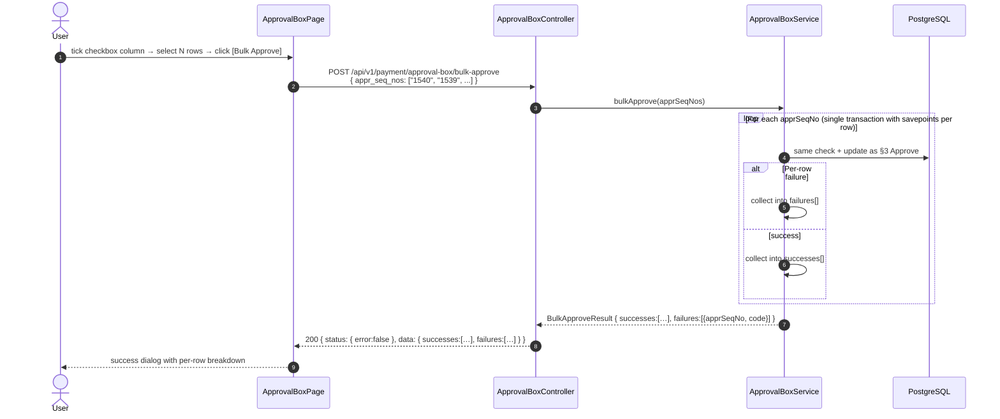
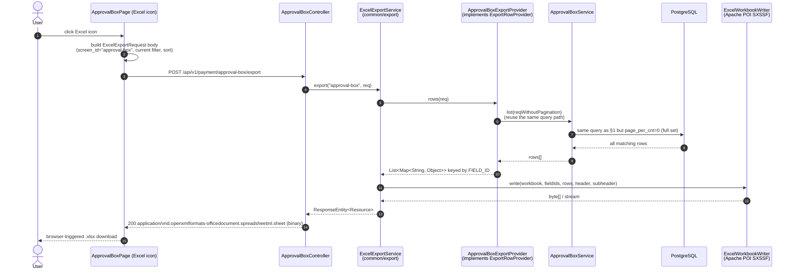

# Approval Box — API Flow (Sequence Diagrams)

**Feature slug:** `approval-box`
**Module:** `payment`
**Date:** 2026-05-13
**Status:** Design — diagrams for the read-path land first; mutation flows are documented for completeness but ship in follow-up MRs (see [migration-plan.md](migration-plan.md)).

Diagrams use Mermaid. Each step is mapped to the JEX equivalent (file:line) so reviewers can trace parity. Legacy WSVC ids appear only as JEX citations — refactor surfaces use the `approval-box` slug per [discovery.md](discovery.md) §9.

---

## 1 · List (in-scope this MR)



**Parity checklist:**
- Validation: [resl_0001_001_r001_act.jsp:54-61](../../../../../WECMS%20DEV/WECMS/web/WEB-INF/action/jex/wabooks/resl/resl_0001_001_r001_act.jsp#L54) → service `validatePeriod`.
- Tenant BIZ_KEY filter: [resl_0001_001_r001_act.jsp:68-69](../../../../../WECMS%20DEV/WECMS/web/WEB-INF/action/jex/wabooks/resl/resl_0001_001_r001_act.jsp#L68) → JPQL `WHERE erm.bizKey = :bizKey`.
- 6-type filter (`21`/`31`/`32`/`33`/`34`/`35`): [resl_0001_001_r001_act.jsp:78](../../../../../WECMS%20DEV/WECMS/web/WEB-INF/action/jex/wabooks/resl/resl_0001_001_r001_act.jsp#L78) → JPQL `IN`.
- Visibility filter (Redmine #42046): [resl_0001_001_r001_act.jsp:114-162](../../../../../WECMS%20DEV/WECMS/web/WEB-INF/action/jex/wabooks/resl/resl_0001_001_r001_act.jsp#L114) → JPQL nested `EXISTS`.
- Approver chain expansion: [resl_0001_001_r001_act.jsp:325-338](../../../../../WECMS%20DEV/WECMS/web/WEB-INF/action/jex/wabooks/resl/resl_0001_001_r001_act.jsp#L325) → repository `findApproversByDocument`.
- Tab counts ignore `apprTypeCd`; rows respect it: preserved exactly (D9 in [design-backend.md](design-backend.md) §13).

---

## 2 · View detail (deferred — documented for context)

The detail popup is owned by `comm_0195_001` in JEX; the refactor port lands in a follow-up MR. Sketch:



**Notes on transaction-table shape (deferred):** the rows-by-type panel — Internal Transfer / Vendor / Expense / Payroll / Overseas / Corporate Card — pulls from `SCDUL_PYMN_SUMR_DETL`, `OVRS_PYMN_SUMR_DETL`, or `CARD_TRNS_HSTR` per `appr_dv`. The detail-MR design doc will spell this out; for now [docs/jex/business-rules/approval.md:175-227](../../../../../docs/jex/business-rules/approval.md#L175) is the source of truth.

---

## 3 · Approve (deferred)

```mermaid
sequenceDiagram
    autonumber
    actor User
    participant FE as ApprovalDetailsModal
    participant API as ApprovalBoxController
    participant Svc as ApprovalBoxService
    participant AuditSvc as AuditLogService
    participant DB as PostgreSQL

    User->>FE: click [Approve] (footer; only enabled when it is this user's turn)
    FE->>API: POST /api/v1/payment/approval-box/{apprSeqNo}/approve
    Note over API: Body intentionally empty —<br/>identity comes from JWT (TenantContext.currentUserId).
    API->>Svc: approve(apprSeqNo)
    Svc->>DB: 1) SELECT EXPT_RESOL_APPRVR_INFM<br/>WHERE BIZ_KEY=? AND APPR_SEQ_NO=?<br/>AND APPRVR_ID = currentUserId<br/>FOR UPDATE
    DB-->>Svc: approver row
    alt Not this user's turn (apprvr_stts != 'P' or earlier step still pending)
        Svc-->>API: BusinessException("WBE_APPROVAL_BOX_NOT_YOUR_TURN")
        API-->>FE: 200 { status: { error:true, code:"WBE_APPROVAL_BOX_NOT_YOUR_TURN" } }
        FE-->>User: warning dialog
    else This user's turn
        Svc->>DB: 2) UPDATE EXPT_RESOL_APPRVR_INFM<br/>SET APPRVR_STTS='A', APPR_DTM=now()<br/>WHERE composite-PK
        DB-->>Svc: 1 row affected
        Svc->>DB: 3) Are there more pending steps?
        DB-->>Svc: count
        alt All steps approved
            Svc->>DB: 4) UPDATE EXPT_RESOL_MSTR<br/>SET APPR_TYPE_CD='01'  /* Approved tab */<br/>WHERE BIZ_KEY=? AND APPR_SEQ_NO=?
        else More steps remain
            Svc->>DB: 4) UPDATE EXPT_RESOL_MSTR<br/>SET APPR_TYPE_CD='03'  /* In Progress */
        end
        Svc->>AuditSvc: append(WSVC_ID="approval-box", op="approve",<br/>actor=currentUserId, target=apprSeqNo)
        AuditSvc->>DB: INSERT INTO AUDIT_LOGS_INFM …
        Svc-->>API: Approval result
        API-->>FE: 200 { status: { error:false }, data: { appr_stts, apprvr_appr_tot_cnt, apprvr_tot_cnt } }
        FE->>FE: refresh row + tab counts (refetch list)
        FE-->>User: success dialog + updated badge
    end
```

**Maps to JEX:** `comm_0195_001_uxxx` approve handler (exact `_act.jsp` to be confirmed in the detail-MR discovery — typically `comm_0195_001_u001_act.jsp`). Status-derivation rules per [docs/jex/business-rules/approval.md:41-54](../../../../../docs/jex/business-rules/approval.md#L41) and [docs/jex/business-rules/approval.md:165-173](../../../../../docs/jex/business-rules/approval.md#L165).

---

## 4 · Reject (deferred)



Rejection at any step cancels the entire workflow per [docs/jex/business-rules/approval.md:173](../../../../../docs/jex/business-rules/approval.md#L173). The `S` status on downstream approvers signals "blocked-by-reject" — same labelling as legacy ([resl_0001_001_osmc.ts:582-585](../../../../../WECMS%20DEV/WECMS_STATIC/ts-src/js/jex/wabooks/resl/resl_0001_001_osmc.ts#L582)).

---

## 5 · Bulk approve (deferred — pending OQ-2)



**Notes:**
- Legacy WeCMS does not implement bulk-approve today (not in OSMC view). Final scope depends on OQ-2 in [discovery.md](discovery.md).
- Transactional behaviour: per-row savepoint, NOT all-or-nothing. The legacy precedent (for bulk delete) at [resl_0001_001_d001_act.jsp:179-237](../../../../../WECMS%20DEV/WECMS/web/WEB-INF/action/jex/wabooks/resl/resl_0001_001_d001_act.jsp#L179) uses one big transaction with rollback-on-error, but approve semantically needs per-row partial success so users see exactly which rows failed (e.g. "not your turn" cases).

---

## 6 · Download (Excel export — in-scope this MR)



**Notes:**
- The XLSX is the same shape produced by `/api/v1/banking/accounts/export` ([wecms-api/CLAUDE.md](../../../../CLAUDE.md) §"Excel export") — one shared pipeline.
- Backend computes a count + total-amount sub-header in the header row, replacing the legacy frontend-side line at [resl_0001_001_osmc.ts:300-306](../../../../../WECMS%20DEV/WECMS_STATIC/ts-src/js/jex/wabooks/resl/resl_0001_001_osmc.ts#L300). Final sub-header format pending OQ-6.
- The frontend never carries an XLSX library — POI on the backend is the single producer ([wecms-api/CLAUDE.md](../../../../CLAUDE.md) §"Tech Stack").

---

## 7 · Error envelope (every flow)

Every error response follows the standard `{ status, timestamp, path, trace_id }` shape, e.g.:

```json
{
  "status":    { "error": true, "code": "WBE_APPROVAL_BOX_INVALID_PERIOD",
                 "message": "Start date must be earlier than or equal to end date." },
  "timestamp": "2026-05-13T08:32:11Z",
  "path":      "/api/v1/payment/approval-box",
  "trace_id":  "20260513083211PT06592776769567DEVL"
}
```

The `trace_id` is the MDC value populated by `JwtAuthenticationFilter` / `TraceId` per [wecms-api/CLAUDE.md](../../../../CLAUDE.md) §"Error handling — every error envelope MUST carry". Frontend dialogs surface it verbatim.

---

## 8 · Cross-references

- [discovery.md](discovery.md) §2.4 — JEX `_act.jsp` files behind each step.
- [design-backend.md](design-backend.md) §4-§7 — controller / service / repository contracts.
- [design-frontend.md](design-frontend.md) §4-§6 — Axios client, page state, error dialogs.
- [docs/jex/business-rules/approval.md](../../../../../docs/jex/business-rules/approval.md) — canonical approval workflow.
