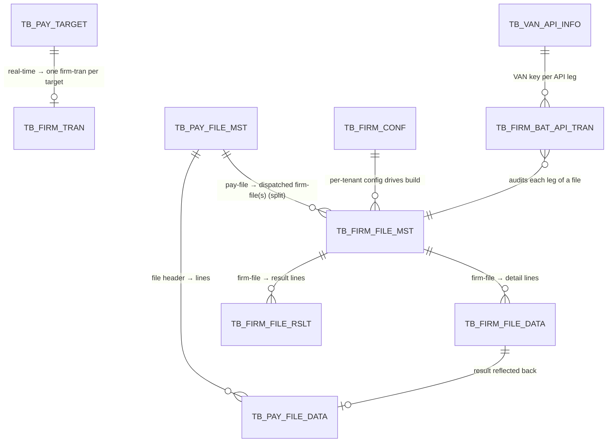

# Database Schema — Dispatch Tables

> Part of the [WeCMS Batch](README.md) feature set. Per-table reference for the ten tables the dispatch engine reads and writes. Column-by-column DDL parity (types, lengths, defaults, PK column order) is the authority at [../../references/database/payment/firm-banking-dispatch-schema.md](../../references/database/payment/firm-banking-dispatch-schema.md) — this doc focuses on **purpose, key columns, relationships, and read/insert/update flows** per table.
>
> **Status:** source-verified 2026-06-24. All tables are in the PROD Active Table List. No FK constraints exist on these tables in legacy DEV — referential integrity is **app-enforced**. Legacy `*_HIS` audit-trigger twins are not ported (the refactor uses `AUDIT_LOGS_INFM` + `TB_FIRM_BAT_API_TRAN`).

---

## Relationship overview

Two independent state machines:
- **Real-time:** `TB_PAY_TARGET.PROC_STAT` `9 → 6 → 0/3`, with a `TB_FIRM_TRAN` row per transfer (201/202/204).
- **File / bulk:** `TB_PAY_FILE_MST.PROC_STAT` `9 → 6 → 0/1/3` driven by `TB_FIRM_FILE_MST.PROC_STEP` `0 → 1 → 2 → 3`.

---

## 1. TB_PAY_TARGET

**Purpose.** Real-time (API/VND-path) payment target — the queue row a committed payment leaves for the dispatch engine.

**Main columns.** PK `(TRAN_DT, BIZ_KEY, TRAN_SEQ)`; `PROC_STAT` (9 WAIT / 6 REQ / 0 SUCC / 3 FAIL); FX columns written by the 204 leg (`DEP_CCY_CD`, `APL_EXC_RATE`, `WITHD_AMT`, `DEP_AMT`).

**Relationships.** One `TB_FIRM_TRAN` row (TRAN_TP='202') reuses this row's `TRAN_SEQ` as the dispatch link (legacy `dep_seq`).

**Flows.** **Read:** `RealtimeDispatchService` re-reads it on `afterCommit` (idempotency). **Insert:** by the payment module, not the dispatch engine (`PROC_STAT='9'`). **Update:** `PROC_STAT` → 0/3 (U002) + FX columns on 204 success; reconciled by `ResultCheckService` for no-response rows.

## 2. TB_FIRM_TRAN

**Purpose.** Per-transfer gateway log — one row per EFS real-time leg (201 inquiry / 202 transfer / 204 FX). The heart of the real-time audit.

**Main columns.** `TRAN_DT`, `BIZ_KEY`, `TRAN_SEQ` (PK has no `TRAN_TP` component — the 202 row reuses the pay-target seq; 204 allocates its own); `TRAN_TP` (201/202/203/204); `PROC_STAT` (6 → 0/3); `BAL_AMT`/`BAL_AMT_SIGN` (balance from 202); FX fields for 204.

**Relationships.** Links back to `TB_PAY_TARGET` by `(TRAN_DT, BIZ_KEY, TRAN_SEQ)`.

**Flows.** **Read:** `TbFirmTranRepository.findByTranTpAndProcStat('202','6')` (result-check); `existsByTranDtAndBizKeyAndTranSeq` (idempotency); `findByBizKeyAndTranDtAndTranSeqIn` (detail batch). **Insert:** at `PROC_STAT='6'` before each gateway call (`FirmTranInquiryAuditService` for 201; `RealtimeDispatchService` for 202/204). **Update:** to 0/3 on outcome (U002/U004/U005).

## 3. TB_PAY_FILE_MST

**Purpose.** File-path payment header — one row per uploaded bulk payment file awaiting dispatch.

**Main columns.** PK `(TRAN_DT, BIZ_KEY, FILE_SEQ_NO)`; `PROC_STAT` (9 WAIT / 6 REQ / 0 all-succ / 1 partial / 3 all-fail).

**Relationships.** Parent of `TB_PAY_FILE_DATA`; fans out to one-or-more `TB_FIRM_FILE_MST` (branch-split).

**Flows.** **Read:** `BulkReceptionService` loads it on `afterCommit`. **Insert:** by the payment module (`PROC_STAT='9'`). **Update:** → `6` at reception start; finalized to `0/1/3` by `BulkExecutionResultService.finalizePayFileStatus` once all firm-file siblings report.

## 4. TB_PAY_FILE_DATA

**Purpose.** File-path payment detail — one row per beneficiary line under a `TB_PAY_FILE_MST`.

**Main columns.** PK `(TRAN_DT, BIZ_KEY, FILE_SEQ_NO, SEQ)`; per-line result fields reflected from the gateway result.

**Relationships.** Child of `TB_PAY_FILE_MST`; its lines are mirrored into `TB_FIRM_FILE_DATA` for dispatch and the result is reflected back.

**Flows.** **Read:** source lines for the file build. **Insert:** by the payment module. **Update:** per-line `PROC_RSLT_DIV`/`RS_CD` reflected from the 01302 result file.

## 5. TB_FIRM_FILE_MST

**Purpose.** Firm-banking dispatch file **header** — one row per dispatched batch file (one pay-file can produce several when branch-split is active). 26 columns.

**Main columns.** PK `(TRAN_DT, BIZ_KEY, FILE_SEQ_NO, FIRM_FILE_NM)`. Key fields: `OUT_BANK_CD`, `BANK_PRTN_ID`, `VAN_ORG_CD`, `FILE_TYPE`, `WDRL_ACT_NO`, `FIRM_FILE_NM` (physical filename), `PROC_STEP` (0 REQ / 1 REQ_RECV / 2 DEPO_REQ / 3 DEPO_RES_RECV), `PROC_STAT`; request/registered/success/unprocessed count+amount pairs (`REQ_CNT`/`REQ_AMT`, `REG_CNT`/`REG_AMT`, `SUCC_*`, `UNPROC_*`); `REG_RSLT_CD`/`REG_RSLT_MSG`.

**Relationships.** Child of `TB_PAY_FILE_MST`; parent of `TB_FIRM_FILE_DATA` and `TB_FIRM_FILE_RSLT`; audited by `TB_FIRM_BAT_API_TRAN`.

**Flows.** **Insert:** `BulkReceptionService` at `PROC_STEP=0`. **Update:** 0→1 (01301 reception, `REG_CNT`/`REG_AMT`), 1→2 (inline 302), 2→3 (01302 execution, `SUCC_*`/`UNPROC_*`).

## 6. TB_FIRM_FILE_DATA

**Purpose.** Firm-banking dispatch **detail lines** — one row per beneficiary in a dispatched file. 24 columns.

**Main columns.** PK `(TRAN_DT, FILE_SEQ_NO, FIRM_FILE_NM, SEQ)` (legacy omits `BIZ_KEY` from the PK; the column stays NOT NULL for joins). Defaults verbatim from DEV: `TRSC_CCY_CD='VND'`, `PROC_RSLT_DIV='N'`.

**Relationships.** Child of `TB_FIRM_FILE_MST`; each line corresponds to a `TB_PAY_FILE_DATA` line and a `TB_FIRM_FILE_RSLT` row.

**Flows.** **Insert:** during file build (Vietnamese tone-normalized via `VietnameseText.replaceTone`). **Update:** `PROC_RSLT_DIV`/`RS_CD` reflected from the parsed result file; the same result reflects onto `TB_PAY_FILE_DATA`.

## 7. TB_FIRM_FILE_RSLT

**Purpose.** Gateway **result rows** — one row per result line returned in the 01302 execution result file (mirrors the corresponding `TB_FIRM_FILE_DATA` row). 22 columns.

**Main columns.** PK `(TRAN_DT, BIZ_KEY, FIRM_FILE_NM, SEQ)`. Defaults: `TRSC_CCY_CD='VND'`, `PROC_RSLT_DIV='N'`.

**Relationships.** Written from the decoded result file; reflected onto `TB_FIRM_FILE_DATA` + `TB_PAY_FILE_DATA`.

**Flows.** **Insert only:** one `TbFirmFileRslt` per decoded D-line in `BulkExecutionResultService` (no update/delete). Drives the final pay-file status.

## 8. TB_FIRM_BAT_API_TRAN

**Purpose.** Batch-level **API audit** — one row per gateway leg (00301 / 01301 / 00302 / 01302), written *before* the call and updated with the result code. 15 columns.

**Main columns.** PK `(TRAN_DT, BIZ_KEY, TRAN_SEQ, API_TRAN_TP, OUT_BANK_CD, BANK_PRTN_ID)` — six-column composite. `API_TRAN_TP` identifies the leg; aggregate counts/amounts + response fields.

**Relationships.** Audits the legs of a `TB_FIRM_FILE_MST` dispatch; the VAN key used is resolved from `TB_VAN_API_INFO`.

**Flows.** **Insert:** before each EFS 301/302 call (`BulkReceptionService`, `BulkReceptionResultService`). **Update:** with the RC after the call. **Read:** for audit/troubleshooting.

## 9. TB_VAN_API_INFO

**Purpose.** Per-VAN API credentials — the gateway API key used to build/sign the request envelope, keyed by `VAN_ORG_CD`.

**Main columns.** `VAN_ORG_CD` + the API key material.

**Relationships.** Consumed by `VanApiKeyService` for every leg before an envelope is built.

**Flows.** **Read only** (`VanApiKeyService.getApiKey`). It throws `IllegalStateException` until the table is seeded (provisioning item **B2**) — there is no fallback key. Never written by the engine; seeded by a DBA (manual SQL, Flyway off).

## 10. TB_FIRM_CONF

**Purpose.** Per-tenant firm-banking configuration — the parameters that drive file build and routing. **Owned by the settings module**, read by dispatch.

**Main columns.** `VAN_ORG_CD`, `OUT_BANK_CD`, `BANK_PRTN_ID`, `WDRL_ACT_NO`, `FILE_TYPE`, branch-split flags (`BAT_TRAN_BRANCH_DIV`, branch limit).

**Relationships.** Gates `BulkReceptionService.receive` and `RealtimeDispatchService`; its branch-split fields drive `calculateBatchDivision`.

**Flows.** **Read only** from the dispatch side. Seeded per-tenant (provisioning item **I5**); missing rows block dispatch — see [troubleshooting.md §6](troubleshooting.md#6-tb_firm_conf-missing).

---

## Appendix — schedule tables (present, not yet consumed)

| Table | Purpose | Status |
|---|---|---|
| `TB_BATCH_SCHEDULE_INFO` | Per-bank batch run-window header (`BATCH_ID`, `OUT_BANK_CD`, start/end time) — **no BIZ_KEY** (global per bank). | Entity + repository exist; the operating-hours gate is **not yet wired** into dispatch (deferred, PO scope). |
| `TB_BATCH_SCHEDULE_DTL` | Per-bank, per-account-class detail of a schedule. | Same — mapped, not consumed. |

These are documented for completeness; they do not affect the current dispatch flow. See [firm-banking-dispatch.md §6](firm-banking-dispatch.md#6-future-improvements).
