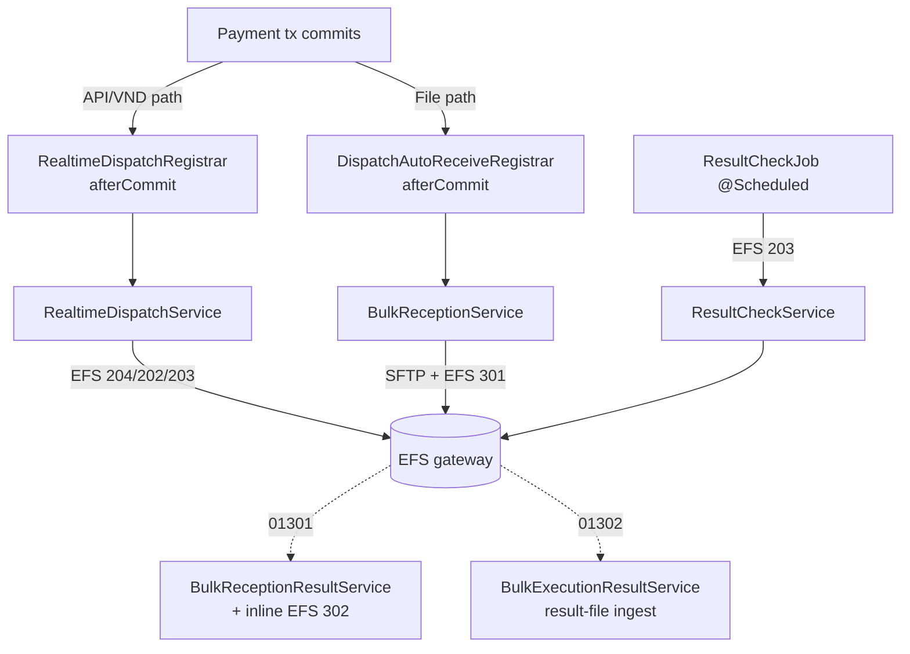
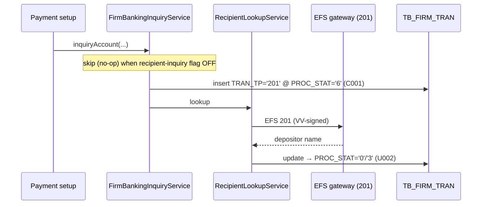
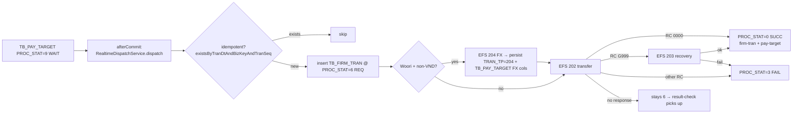
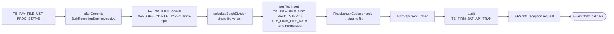
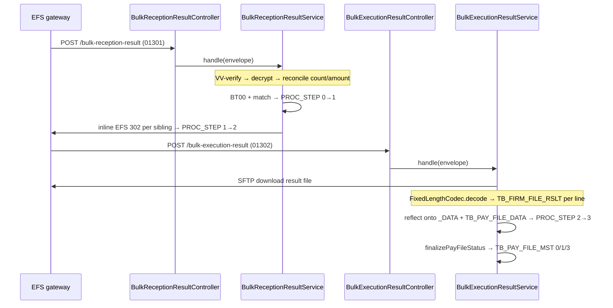
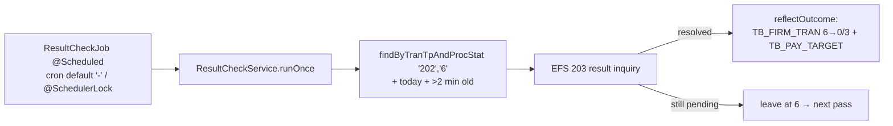

# Firm-Banking Dispatch — Feature Guide

> Part of the [WeCMS Batch](README.md) feature set. This is the behavioral + architectural reference for the dispatch engine. Trigger/scheduling detail is in [scheduler-flow.md](scheduler-flow.md); tables in [database-schema.md](database-schema.md); legacy traceability in [legacy-jex-mapping.md](legacy-jex-mapping.md).
>
> **Status:** code-complete, inert by default (flags OFF). Source-verified 2026-06-24.

---

## 1. Business purpose

Firm-banking dispatch is the engine that delivers a committed WeCMS payment to the bank and reconciles the outcome. It serves two payment shapes and one synchronous lookup:

- **Real-time transfer** — a single VND / API-path payment is pushed to the gateway the moment it commits (EFS 202; EFS 204 Woori FX pre-rate first for non-VND Woori transfers).
- **File / bulk transfer** — many beneficiaries are packed into a fixed-length deposit file, uploaded by SFTP, accepted (EFS 301), then executed (EFS 302); the bank later returns a result file.
- **Depositor inquiry** — a synchronous account-holder name check before a transfer is set up (EFS 201).

A single scheduled sweep (EFS 203) reconciles any transfer the bank did not answer in time. Every leg writes a DB audit row, and the full `PROC_STAT` / `PROC_STEP` state machine is preserved so each dispatch is traceable end-to-end.

The engine is **dormant until provisioned**: six feature flags default OFF and the mock gateway/SFTP clients throw on use, so the module never co-processes live bank traffic until it is explicitly switched on (see [deployment-guide.md](deployment-guide.md)).

---

## 2. Legacy JEX architecture (source of truth)

The behavior the engine reproduces came from a **separate JEX batch deployment** — timed JSP "batch" programs plus a synchronous inquiry service. They are not in this workspace; the structural reference is the legacy entity set and `IMO.WB_00000100.xml`. The per-program mapping lives in [legacy-jex-mapping.md](legacy-jex-mapping.md).

| JEX component | Role |
|---|---|
| **JSP batch programs** | `NAPAS_REAL_TIME_BATCH`, `FILE_DEPOSIT_TRANSFER_BATCH1/2`, `PROCESSING_RESULT_CHECK_BATCH` — each scanned a status column and acted on matching rows. |
| **Callback JSPs** | `FILE_DEPOSIT_TRANSFER_API1_act.jsp` (01301 reception), `FILE_DEPOSIT_TRANSFER_API2_act.jsp` (01302 execution). |
| **IDO queries** | XML SQL (e.g. `TB_FIRM_TRAN_R001` selecting `TRAN_TP='202' AND PROC_STAT='6'`). |
| **JexData / JexConnection / JexContext** | Untyped row container, JDBC/tx handle, per-run context (tenant / product / env). |
| **Helpers** | `PymnHelper` (bank-code + UAT override, `:916-946`), `util.SftpUtil` (60 s SFTP), `consts.WCConst` (result codes), `Deposit_Header/Data/Trailer` (file builders). |

The legacy model was **polling-based** (scan `PROC_STAT='9'` / `PROC_STEP=1` / `PROC_STAT='6'` on a timer) and JEX-runtime-coupled, which made it hard to test and observe.

---

## 3. Spring Boot architecture

Everything lives under `com.kosign.wecms.domain.payment.dispatch.**`:

```
dispatch/
├─ service/     RealtimeDispatchService · RealtimeTransferService · BulkReceptionService
│               ResultCheckService · DispatchKeyGenerator · *Registrar (afterCommit)
├─ scheduler/   ResultCheckJob            // @Scheduled + @SchedulerLock (ShedLock)
├─ callback/    controller/Bulk{Reception,Execution}ResultController
│               service/Bulk{Reception,Execution}ResultService · CallbackIpWhitelistFilter
├─ van/client/  EfsApiClient → RestClientEfsApiClient | MockEfsApiClient   // @ConditionalOnProperty
│               EfsProperties · EfsCryptoService    // AES-256/CBC + HMAC-SHA256
├─ sftp/        SftpClient → JschSftpClient | MockSftpClient · SftpProperties
├─ file/        FixedLengthCodec          // 1000-byte H/D/T (998 + CRLF), UTF-8
├─ constant/    FirmBankingResultCd       // 0000 SUCC · 9999 AMT_ERR · G999 ETC_ERR …
└─ entity/      TbFirmTran · TbPayTarget · TbFirmFile{Mst,Data,Rslt} · TbFirmBatApiTran …
```

**Layering** (controller → service → repository → entity) holds, with two notes:
- The only **controllers** are the inbound callback endpoints; outbound dispatch is triggered internally (event hooks / scheduler), not by a client request.
- `EfsApiClient` and `SftpClient` are **interfaces** with a real and a mock implementation chosen by `@ConditionalOnProperty`; the mock throws `UnsupportedOperationException` so a disabled leg fails loudly rather than silently succeeding.

**Key collaborators**

| Concern | Class |
|---|---|
| Gateway transport | `EfsApiClient` → `RestClientEfsApiClient` (real, `RestClient`) / `MockEfsApiClient`; legs `EFS_201..EFS_302` → `/WGVN_EFS_{201,202,203,204,301,302}.jct` |
| Crypto | `EfsCryptoService` — AES-256/CBC/PKCS5 (EV) + HMAC-SHA256 (VV) + constant-time verify |
| SFTP | `SftpClient` → `JschSftpClient` (JSch) / `MockSftpClient`; `SftpProperties` |
| File codec | `FixedLengthCodec` — `CONTENT_LEN=998` + CRLF = `RECORD_LEN=1000`; markers `H`/`D`/`T`; UTF-8 |
| VAN key | `VanApiKeyService` — per-`vanOrgCd` key from `TB_VAN_API_INFO`, resolved before any envelope is built |
| Key generation | `DispatchKeyGenerator` → `LegacyFunctionRepository` → `wb_get_next_val` (single funnel) |
| Result codes | `constant/FirmBankingResultCd`; status enums `ProcStat`, `ProcStep`, `TranTp` |

---

## 4. Batch flow diagrams

### 4.1 Top-level



### 4.2 Depositor inquiry flow



Account *balance* is no longer a separate inquiry — it rides inside the EFS 202 transfer response.

### 4.3 Realtime dispatch flow



`RealtimeDispatchService.dispatch` runs in `@Transactional(propagation = REQUIRES_NEW)` so a failed transfer commits its FAIL status independently and never rolls back the payment. The 204 FX leg (`runFxInquiry`) allocates an independent `TRAN_SEQ`, persists a `TRAN_TP='204'` row, and on success writes `DEP_CCY_CD/APL_EXC_RATE/WITHD_AMT/DEP_AMT` onto both the 204 row (U005) and `TB_PAY_TARGET` (U002).

### 4.4 File dispatch flow



Branch-split (legacy C5): when `BAT_TRAN_BRANCH_DIV='Y'` and `reqCnt>limit`, the batch splits into `ceil(reqCnt/limit)` files, each with its own round / `FIRM_FILE_NM` / MST / DATA / SFTP / 301. SFTP/EFS failure marks the file FAIL and breaks the per-file loop (legacy R004 parity); it never rethrows into the payment tx.

### 4.5 Callback flow



Both callbacks are VV-verified **before** decrypt. A count/amount mismatch on 01301 marks the file FAIL (`REG_RSLT_CD='9999'`) and suppresses the 00302. A malformed result file on 01302 **throws** so the callback tx rolls back and the file is replayable at `PROC_STEP=2`. The execution request (EFS 302) is issued **inline** from the reception callback — there is no standalone second batch.

### 4.6 Result-check flow



This is the only `@Scheduled` job. Cron defaults to `"-"` (never fires). Details in [scheduler-flow.md](scheduler-flow.md).

---

## 5. Design decisions

Deliberate choices that differ from the legacy implementation — do **not** "fix" them. Legacy traceability for each is in [legacy-jex-mapping.md](legacy-jex-mapping.md).

| Decision | Rationale |
|---|---|
| **Event-driven, not polling** — dispatch fires on `afterCommit`, not a status scan. | Lower latency, no idle scanning; one target / file per commit, isolated. |
| **Execution (302) absorbed into the 01301 callback** — no standalone second batch. | Removes a scan + a timer's latency (architecture decision K9). |
| **Socket → REST gateway transport** via `.jct` URLs. | Standard `RestClient`; testable, timeout-configurable. |
| **204 FX persistence implemented.** | A `TRAN_TP='204'` audit row + `TB_PAY_TARGET` FX columns are written (matches legacy `NAPAS_REAL_TIME_BATCH`). |
| **Slack `MsgSendUtil` alerting not ported** — logging-only. | Structured `WBExxxx` + request-scoped `trace_id`; porting Slack is an open PO decision. |
| **Audit triggers → `AUDIT_LOGS_INFM` + `TB_FIRM_BAT_API_TRAN`**; legacy `*_HIS` twins not ported. | Refactor audit model; avoids trigger DDL. |
| **SFTP/EFS run inside the `@Transactional` unit** (legacy ran them outside). | Accepted for low-volume R&D; re-evaluate at PROD volume. |

**Error handling.** `GlobalExceptionHandler` is the single funnel. Dispatch raises `WBE_EFS_GATEWAY_ERROR` (non-`0000`/non-`G999` result), `WBE_EFS_VERIFY_FAILED` (VV/EV failure), `WBE_EFS_RESULT_FILE` (download/parse failure). Gateway result codes are `FirmBankingResultCd` constants (`0000` SUCC, `0001` NO_FOUND, `9999` AMT_ERR, `G001..G004`, `G998`, `G999` ETC_ERR). Business outcomes are committed as status writes; only infrastructure faults roll back for replay.

---

## 6. Future improvements

None is a missing core flow — see [../../audits/wecms-batch-full-legacy-vs-refactor-final-gap-audit.md](../../audits/legacy-parity/wecms-batch-full-legacy-vs-refactor-final-gap-audit.md) for the authoritative list.

- **Code (small):** result-check day-boundary fix (use a `RQ_DTTM`/timestamp range instead of same-day + `HHmmss` string compare before enabling the cron in PROD); correct the stale `ResultCheckService` class Javadoc.
- **Deferred pre-flight features (PO scope):** operating-hours window gate (`TB_BATCH_SCHEDULE_*` entities exist but are not consumed), channel-mix validation (EBANK / VCB / CITAD / NAPAS), UAT Shinhan (`970424`) / Woori (`970457`) bank-code override (**mandatory before any UAT/PROD activation on those two banks**), Slack alerting.
- **SIT verification:** confirm the full `BT00` reception-code set; byte-parity of the fixed-length file + EV/VV encode vs captured gateway samples (B5); the V1–V6 round-trips.
- **Operational:** revisit the in-transaction SFTP/EFS model and add a durable/multi-instance ShedLock posture if PROD volume grows; containerization (no Dockerfile yet).

See [deployment-guide.md](deployment-guide.md) for the activation sequence and [troubleshooting.md](troubleshooting.md) for operational diagnostics.
