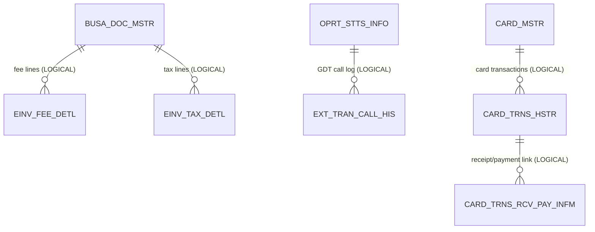

# Add-on Service — ERD

**Modules:** `domain/einvoice`, `domain/operation`, `domain/payment/cardtransactions`
**Diagram source:** [`diagrams/addon-service-erd.mmd`](diagrams/addon-service-erd.mmd)
**Generated:** 2026-06-01 · from Flyway migrations + JPA entities.

Add-on Service groups the value-added features: e-Invoice (Sales / Expenses), tax-authority Operation Status, and Card Transactions. All tables are tenant-scoped by `BIZ_KEY`.

> **Removed tables:** the Sprint-1 report tables `BUSI_COND_DAILY_SUMR(_DETL)`, `SELL_HIS_DAILY_SUMR(_DETL)` and `BAT_CALL_HIS` (created V14) were **dropped in V31** — they are not in the PROD active list and PROD never populated them. They are excluded from this ERD. Daily-cash reporting lives in Banking's `DAILY_CASH_REPT_DAILY_SUMR_DETL` (V125).

Full attribute detail: [`diagrams/addon-service-erd.mmd`](diagrams/addon-service-erd.mmd).

## Tables by sub-module

### e-Invoice (`domain/einvoice`)
| Table | Source | Purpose | PK |
|---|---|---|---|
| `BUSA_DOC_MSTR` | V15 (+V23 → 100 cols, +V24 UK/CHECK) | Invoice / business-document master, `DOC_TYPE` I=Sales, B=Expense | `(BIZ_KEY, DOC_ID)` |
| `EINV_FEE_DETL` | V15 | Per-invoice fee detail lines | `(BIZ_KEY, DOC_ID, DISP_ORD)` |
| `EINV_TAX_DETL` | V15 | Per-invoice tax-rate breakdown lines | `(BIZ_KEY, DOC_ID, DISP_ORD)` |

### Operation Status (`domain/operation`)
| Table | Source | Purpose | PK |
|---|---|---|---|
| `OPRT_STTS_INFO` | V16 | Tax-authority (GDT) operation-status snapshot per company tax code | `(BIZ_KEY, TAXCODE)` |
| `EXT_TRAN_CALL_HIS` | V16 | External-call audit log (GDT bridge, deferred consumer) | `(SVC_ID, REF_DATE, SEQ_NO)` |

### Card Transactions (`domain/payment/cardtransactions`)
| Table | Source | Purpose | PK |
|---|---|---|---|
| `CARD_MSTR` | V192 | Card registry (filter dropdown + LEFT JOIN display names) | `(BIZ_KEY, BANK_CD, CARD_NO)` |
| `CARD_TRNS_HSTR` | **V192** (redefines the earlier V184) | One row per scraped card transaction | `(BIZ_KEY, CARD_SEQ_NO)` |
| `CARD_TRNS_RCV_PAY_INFM` | V200 | Card-link master (child documents live on `BUSA_DOC_RCV_PAY_HIS`) | `(BIZ_KEY, CARD_SEQ_NO, RCV_PAY_SEQ_NO)` |

> **V184 vs V192 reconciliation:** `CARD_TRNS_HSTR` is created by both V184 (early cash-flow phase) and V192 (full card module). Both use `CREATE TABLE IF NOT EXISTS`, so on a fresh DB V184 lands first; V192 adds three helper indexes (`ix_card_trns_hstr_biz_trsc_dt`, `ix_card_trns_hstr_biz_card`, `ix_card_trns_hstr_biz_appr_seq`). **V192 is the authoritative final shape.**

## Key columns & conventions

- **Audit columns:** `REG_ID/REG_DTM/MOD_ID/MOD_DTM` `VARCHAR(14)` on `BUSA_DOC_MSTR`, `OPRT_STTS_INFO`, `CARD_*`; `EINV_*` detail tables carry the four; `EXT_TRAN_CALL_HIS` carries `REG_DTM` only.
- **State / use flags:** `BUSA_DOC_MSTR.HAND_REG_YN` (baseline filter `='N'`) + `PROV_STTS` (baseline excludes `VD`/`EE`); `CARD_MSTR.ACTV_YN`; `CARD_TRNS_HSTR.ERP_SND_YN`.
- **Code / enum columns:** `DOC_TYPE` (I/B), `INV_TYPE` (C/tax), `PROV_STTS` (OP/PP/PA/VD/EE), `PAY_DUE_CD` (15/30/60/00), `CARD_TYPE_CD`, `INOUT_DV` (0/1/2). `OPRT_STTS_INFO.COMPANYSTATUS` is **free-form Vietnamese GDT text** — the canonical 3-state code is derived server-side, never persisted.
- **Important indexes:** `ix_busa_doc_mstr_biz_type_dt`, `busa_doc_mstr_uk01 (BIZ_KEY, REG_DT, SEQ_NO)`, `ix_oprt_stts_biz_dtm`, plus the three V192 card indexes above.

## Relationships

| From | To | Kind | Via |
|---|---|---|---|
| `BUSA_DOC_MSTR` | `EINV_FEE_DETL` / `EINV_TAX_DETL` | **Logical — no FK** | `(BIZ_KEY, DOC_ID)` |
| `BUSA_DOC_MSTR` | `BUSA_DOC_RCV_PAY_HIS` (banking) | **Logical — no FK** | `DOC_ID` |
| `OPRT_STTS_INFO` | `EXT_TRAN_CALL_HIS` | **Logical — no FK** | `TAXCODE` |
| `OPRT_STTS_INFO` | `BUSA_DOC_MSTR` | **Logical — no FK** | `TRCO_TAX_ID` / `TAXCODE` (status badge) |
| `CARD_MSTR` | `CARD_TRNS_HSTR` | **Logical — no FK** (LEFT JOIN) | `(BIZ_KEY, BANK_CD, CARD_NO)` |
| `CARD_TRNS_HSTR` | `CARD_TRNS_RCV_PAY_INFM` | **Logical — no FK** | `(BIZ_KEY, CARD_SEQ_NO)` |
| `EXPT_RESOL_MSTR` (payment) | `CARD_TRNS_HSTR` | **Logical — no FK** | `APPR_SEQ_NO` |
| `CHART_ACCT_INFM` (settings) | `CARD_TRNS_HSTR` | **Logical — no FK** | `CHART_ACCT_SEQ_NO` |

No declared `FOREIGN KEY` constraints on any Add-on table (legacy parity — `BUSA_DOC_MSTR`'s V24 FKs target out-of-scope tables and were deferred).

## Related docs

- Schema notes: [`../addon/sales-e-invoices-db.md`](../addon/sales-e-invoices-db.md), [`../addon/expenses-e-invoices-db.md`](../addon/expenses-e-invoices-db.md), [`../addon/operation-status-inquiry-db.md`](../addon/operation-status-inquiry-db.md), [`../card-transactions.md`](../card-transactions.md)
- Business rules: [`../../../business-rules/`](../../business-rules/) · Feature specs: [`../../../features/`](../../../features/)
- JEX functional spec: [`../../../../jex/business-rules/tax.md`](../../../../../docs/jex/business-rules/)
