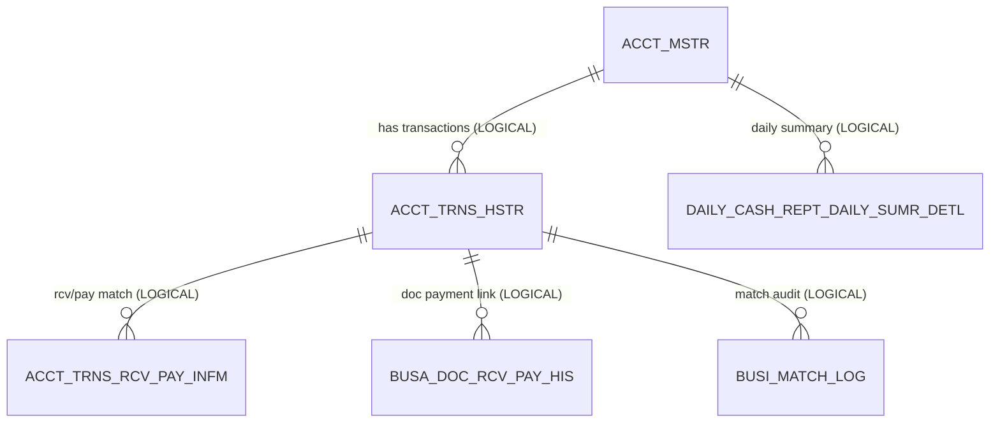

# Banking — ERD

**Module:** `domain/banking`
**Diagram source:** [`diagrams/banking-erd.mmd`](diagrams/banking-erd.mmd)
**Generated:** 2026-06-01 · from Flyway migrations (`src/main/resources/db/migration`) + JPA entities.

All Banking tables are **multi-tenant**, scoped by `BIZ_KEY`. Almost no foreign keys are declared in SQL — the legacy JEX schema relies on application-level referential integrity, so most relationships below are marked **Logical — no FK found**.

> **Removed table:** `ACCT_TRNS_RCV_PAY_EVID_FILE` (created V13) was **dropped in V31** as not-in-PROD-active-list. It is no longer part of the live schema and is excluded here.

See the full attribute-level diagram in [`diagrams/banking-erd.mmd`](diagrams/banking-erd.mmd).

> ⚠️ **Migration column regenerated from disk 2026-08-17.** The [2026-06-09 rebaseline](../flyway-migration-baseline.md)
> reassigned every Flyway number to a one-table-per-migration scheme; the values below name the migration
> that creates each table **today**. Rows marked **DROPPED** / **no refactor DDL migration** have no current
> migration — that is accurate, not a gap.

## Tables

| Table | Source | Purpose | PK |
|---|---|---|---|
| `ACCT_MSTR` | V2 | Bank account master — one row per tenant/bank/account | `(BIZ_KEY, BANK_CD, ACCT_NO)` |
| `ACCT_TRNS_HSTR` | V3 | Bank transaction history — one row per statement line | `(BIZ_KEY, ACCT_SEQ_NO)` |
| `ACCT_TRNS_RCV_PAY_INFM` | V4 | Receipt/payment match info attached to a transaction | `(BIZ_KEY, ACCT_SEQ_NO, RCV_PAY_SEQ_NO)` |
| `BUSA_DOC_RCV_PAY_HIS` | V25 | History link from a business document to a receipt/payment row | `(BIZ_KEY, DOC_ID, SEQ_NO)` |
| `NAPAS_REMIT_TRNS_HSTR` | V69 | NAPAS inter-bank remittance / transfer history | `(BIZ_KEY, SEQ_NO)` |
| `BANK_EXCH_RATE_INFM` | V10 | FX rates (Coocon/Shinhan feed, batch-populated) | `(BIZ_KEY, BANK_CD, REF_DATE, CCY_CD, EXCH_SEQ_NO)` |
| `RMRK_ORG_INFM` | V85 | Smart Organizer auto-classification rules | `(BIZ_KEY, RMRK_SEQ_NO)` |
| `MEMO_INFM` | V65 | Polymorphic memo/note attached to any page row | `(BIZ_KEY, WEB_SVC_ID, SEQ_NO)` |
| `BUSI_MATCH_LOG` | V33 | Audit/lock log of transaction↔payment match operations | `(BIZ_KEY, MATCH_LOG_SEQ)` |
| `DAILY_CASH_REPT_DAILY_SUMR_DETL` | V45 | Daily cash report — per-account daily balance/in/out summary | `(BIZ_KEY, REF_DATE, ACCT_TYPE_CD, CCY_CD, BANK_CD, ACCT_NO)` |

`NXSIAS_MODULE_TRAN_LOG_HIS` (bank-scraping gateway audit) is documented under [Settings → firm-banking-history](settings-erd.md) — its primary feature home — but is also written by Banking scraping flows.

## Key columns & conventions

- **Audit columns:** `REG_ID`, `REG_DTM`, `MOD_ID`, `MOD_DTM` — all `VARCHAR(14)` (`yyyyMMddHHmmss`), legacy parity. `DAILY_CASH_REPT_DAILY_SUMR_DETL` is a summary table with no audit trail.
- **Use / state flags:** `ACCT_MSTR.ACTV_YN`, `ACCT_TRNS_HSTR.LINK_MATCH_YN` (matched to a payment), `ACCT_TRNS_HSTR.LOCKED_YN` (user-locked against sync overwrite), `ACCT_TRNS_RCV_PAY_INFM.CNFM_YN`, `BUSI_MATCH_LOG.LOCKED_YN`, `BANK_EXCH_RATE_INFM.ERP_SND_YN`.
- **Code / enum columns:** `ACCT_MSTR.ACCT_TYPE_CD` (→ `common/enums/AcctTypeCd`), `CCY_CD`, `ACCT_TRNS_HSTR.INOUT_DV` (→ `common/enums/InoutDv`), `RMRK_ORG_INFM.RCV_PAY_DV` (RCV|PAY) + `MATCH_TYPE` (E exact / I ilike), `NAPAS_REMIT_TRNS_HSTR.TRNS_STTS`, `MEMO_INFM.COLOR`.
- **Dedup hashes:** `ACCT_TRNS_HSTR.BANK_TRNS_FULL_ID` / `BANK_TRNS_SHORT_ID` are sync idempotency keys (indexed `ix_acct_trns_hstr_biz_full_id`, V168).
- **Important indexes:** `ix_acct_mstr_biz_ccy`, `ix_acct_trns_hstr_acct (BIZ_KEY, BANK_CD, ACCT_NO, TRSC_DT)`, `ix_napas_remit_biz_dtm`, `IDX_BANK_EXCH_RATE_INFM_BIZ_DATE`, `IX_RMRK_ORG_INFM_BIZ_DISP`, `ix_memo_infm_biz_svc_ref`, `IX_BUSI_MATCH_LOG_BIZ_BANK` / `_BIZ_PAY`.

## Relationships

| From | To | Kind | Via |
|---|---|---|---|
| `ACCT_MSTR` | `ACCT_TRNS_HSTR` | **Logical — no FK** | `BANK_CD, ACCT_NO` (denormalised on history) |
| `ACCT_MSTR` | `DAILY_CASH_REPT_DAILY_SUMR_DETL` | **Logical — no FK** | composite `BANK_CD, ACCT_NO` |
| `ACCT_TRNS_HSTR` | `ACCT_TRNS_RCV_PAY_INFM` | **Logical — no FK** | `ACCT_SEQ_NO` |
| `ACCT_TRNS_HSTR` | `BUSA_DOC_RCV_PAY_HIS` | **Logical — no FK** | `ACCT_SEQ_NO` |
| `ACCT_TRNS_HSTR` | `BUSI_MATCH_LOG` | **Logical — no FK** | `BANK_TRNS_*_ID` |
| `BANK_INFM` (shared) | `ACCT_MSTR`, `ACCT_TRNS_HSTR`, `BANK_EXCH_RATE_INFM` | **Logical — no FK** | `BANK_CD` |
| `BANK_INFM` / `NAPAS_BANK_INFO` (shared) | `NAPAS_REMIT_TRNS_HSTR` | **Logical — no FK** | `OUT_BANK_CODE` / `IN_NAPAS_BANK_CODE` |
| `TRCO_INFM` (settings) | `ACCT_TRNS_RCV_PAY_INFM` | **Logical — no FK** | `RCV_PAY_TRCO_KEY` |

No declared `FOREIGN KEY` constraints exist on any Banking table — referential integrity is enforced in the service layer.

## Related docs

- Schema notes: [`../banking/account-inquiry-vnd-db.md`](../banking/account-inquiry-vnd-db.md), [`../banking/account-inquiry-fcy-db.md`](../banking/account-inquiry-fcy-db.md), [`../banking/own-account-transfer-db.md`](../banking/own-account-transfer-db.md)
- Business rules: [`../../../business-rules/`](../../business-rules/) · Feature specs: [`../../../features/`](../../../features/)
- JEX functional spec: [`../../../../jex/business-rules/banking.md`](../../../../../docs/jex/business-rules/)
