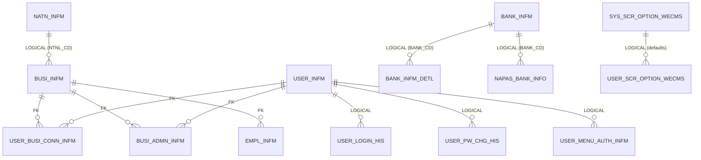

# Shared / Common — ERD

**Modules:** `domain/auth`, `domain/common`, `common/*` (cross-cutting infrastructure)
**Diagram source:** [`diagrams/common-erd.mmd`](diagrams/common-erd.mmd)
**Generated:** 2026-06-01 (ERD Phase 2) · from Flyway migrations + JPA entities.

These **16 tables** back authentication, multi-tenancy, reference data, audit logging, and the global View-Setting / menu features. They are consumed by **every** module — `BUSI_INFM` is the multi-tenant hub and `BIZ_KEY` is the spine that connects the whole schema. This doc is the dedicated companion to the cross-module map in [full-project-erd.md](full-project-erd.md) (which embeds the same content for the project-wide view).

Full attribute detail: [`diagrams/common-erd.mmd`](diagrams/common-erd.mmd).

> ⚠️ **Migration column regenerated from disk 2026-08-17.** The [2026-06-09 rebaseline](../flyway-migration-baseline.md)
> reassigned every Flyway number to a one-table-per-migration scheme; the values below name the migration
> that creates each table **today**. Rows marked **DROPPED** / **no refactor DDL migration** have no current
> migration — that is accurate, not a gap.

## Tables by sub-group

### Auth & tenancy (`domain/auth`)
| Table | Source | Purpose | PK |
|---|---|---|---|
| `BUSI_INFM` | V32 | Company / tenant master — the multi-tenant hub | `BIZ_KEY` |
| `USER_INFM` | V128 | User master (login credentials, flags) | `USER_ID` |
| `USER_BUSI_CONN_INFM` | V125 | User ↔ company linkage (one user → one active company is the operational model) | `(USER_ID, BIZ_KEY)` |
| `USER_LOGIN_HIS` | V129 | Login-attempt audit (success/fail rows) | `(USER_ID, REG_DTM, REG_UID)` |
| `USER_PW_CHG_HIS` | V132 | Password-change history (reuse-prevention ledger) | `(USER_ID, REG_SEQ_NO)` |
| `EMPL_INFM` | V52 | Employee master | `(BIZ_KEY, EMPL_NO)` |
| `BUSI_ADMN_INFM` | V27 | Per-tenant admin authority source (presence = ADMIN) | `(BIZ_KEY, USER_ID)` |

### Reference data (`domain/common`)
| Table | Source | Purpose | PK |
|---|---|---|---|
| `BANK_INFM` | V11 | Vietnamese bank registry (`BANK_CD` → display name) | `BANK_CD` |
| `BANK_INFM_DETL` | V12 | Bank detail / short-name info (no JPA entity — accessed via period-limit projection) | `(BANK_CD, BANK_DETL_INFO_CD, START_DATE)` |
| `NAPAS_BANK_INFO` | V67 | NAPAS code → internal bank-code lookup | `NAPAS_BANK_CD` |
| `NATN_INFM` | V70 | Country master (phone-country picker) | `NTNL_CD` |

### Cross-cutting infrastructure (`common/*`)
| Table | Source | Purpose | PK |
|---|---|---|---|
| `AUDIT_LOGS_INFM` | V8 | Shared audit log — one row per Create/Update per locale (EN/KO/VI/KM); `WSVC_ID` = route slug | `(BIZ_KEY, AUDIT_LOGS_SEQ_NO, WSVC_ID, LANG_CD)` |
| `SYS_SCR_OPTION_WECMS` | V93 | View-Setting **system defaults** (column visibility / order / size) | `(WEB_SVC_ID, FIELD_ID)` |
| `USER_SCR_OPTION_WECMS` | V133 | View-Setting **per-user overrides** | `(BIZ_KEY, USER_ID, WEB_SVC_ID, FIELD_ID)` |
| `USER_MENU_AUTH_INFM` | V131 | Per-user menu entitlements (`USE_YN='Y'` rows; absence = deny) | `(BIZ_KEY, USER_ID, MENU_AUTH_CD)` |
| `shedlock` | V210 | ShedLock distributed scheduler lock (library-managed, no JPA entity) | `name` |

## Key columns & conventions

- **Audit columns:** auth/reference business tables use `REG_ID/REG_DTM/MOD_ID/MOD_DTM` `VARCHAR(14)` (legacy parity). View-Setting tables (`*_SCR_OPTION_WECMS`) and `USER_MENU_AUTH_INFM` use `TIMESTAMPTZ` (refactor-only deviation). `USER_LOGIN_HIS.REG_DTM` / `USER_PW_CHG_HIS.REG_DTM` are `TIMESTAMPTZ`. `shedlock` uses plain `TIMESTAMP`.
- **State / use flags:** `BUSI_INFM.DEL_YN` + `BUSI_STTS`; `USER_INFM.ACTV_YN` / `LOCK_YN` / `DEL_YN`; `USER_BUSI_CONN_INFM.DEL_YN`; `SYS_SCR_OPTION_WECMS.USE_YN`/`FIX_YN`/`DISP_YN`/`SORT_YN`; `USER_MENU_AUTH_INFM.USE_YN` (Y-only storage convention).
- **Code / enum columns:** `BUSI_INFM.PRDT_TYPE` (→ `common/enums/PrdtType`; F/M/H modelled, 11 letters carried verbatim), `NTNL_CD`, `USER_INFM.LANG_CD` (→ `common/enums/LangCd`), `USER_LOGIN_HIS.LGN_CHNL` (PC/MOB) + `RSLT_CD` (SUCCESS/FAIL), `AUDIT_LOGS_INFM.LANG_CD` + `WSVC_ID` (route slug, never legacy WSVC id), `BANK_INFM_DETL.BANK_DETL_INFO_CD`.
- **Important indexes:** `IX_USER_BUSI_CONN_INFM_USER`, `IX_USER_LOGIN_HIS_RSLT`, `ix_user_pw_chg_his_user_reg_dtm`, `ix_empl_infm_biz_date`, `ix_natn_infm_natl_nm`, `ix_audit_logs_infm_ref_lookup`, `IX_USER_SCR_OPTION_WECMS_USER`, `ix_user_menu_auth_biz_user`.

## Relationships

| From | To | Kind | Via |
|---|---|---|---|
| `BUSI_INFM` | `USER_BUSI_CONN_INFM` | **FK declared** (`FK_UBCI_BUSI`) | `BIZ_KEY` |
| `USER_INFM` | `USER_BUSI_CONN_INFM` | **FK declared** (`FK_UBCI_USER`) | `USER_ID` |
| `BUSI_INFM` / `USER_INFM` | `BUSI_ADMN_INFM` | **FK declared** | `BIZ_KEY` / `USER_ID` |
| `BUSI_INFM` | `EMPL_INFM` | **FK declared** (`fk_empl_infm_busi`) | `BIZ_KEY` |
| `USER_INFM` | `USER_LOGIN_HIS` / `USER_PW_CHG_HIS` / `USER_MENU_AUTH_INFM` / `USER_SCR_OPTION_WECMS` | **Logical — no FK** | `USER_ID` |
| `NATN_INFM` | `BUSI_INFM` | **Logical — no FK** | `NTNL_CD` |
| `BANK_INFM` | `BANK_INFM_DETL` / `NAPAS_BANK_INFO` / `EMPL_INFM` | **Logical — no FK** | `BANK_CD` |
| `SYS_SCR_OPTION_WECMS` | `USER_SCR_OPTION_WECMS` | **Logical — no FK** | `WEB_SVC_ID, FIELD_ID` (lazy-init defaults) |

### Hub → every module
`BUSI_INFM` is referenced (mostly **logically** via `BIZ_KEY`) by every tenant-scoped table in Banking, Payment, Add-on Service, and Settings. The only **declared** FKs to `BUSI_INFM` outside this group are `SCDUL_PYMN_SUMR`, `EXPT_RESOL_MSTR`, `PGRO_BSAC_LNKN_INFM`, and `BUSI_ENV_SET_INFM`. See the cross-module table in [full-project-erd.md](full-project-erd.md#cross-module-relationships).

## Related docs

- ERD index: [README.md](README.md) · Full map: [full-project-erd.md](full-project-erd.md)
- Feature specs: [`../../../features/auth/`](../../../features/auth/) (login-auth), [`../../../features/common/view-setting.md`](../../../features/common/view-setting.md)
- Audit logging: [`docs/security/`](../../../../../docs/security/) · View Setting: [`docs/jex/features/view-setting.md`](../../../../../docs/jex/features/view-setting.md)
- Coverage matrix: [`../database-coverage-matrix.md`](../database-coverage-matrix.md) · Ownership: [`../table-ownership.md`](../table-ownership.md)
