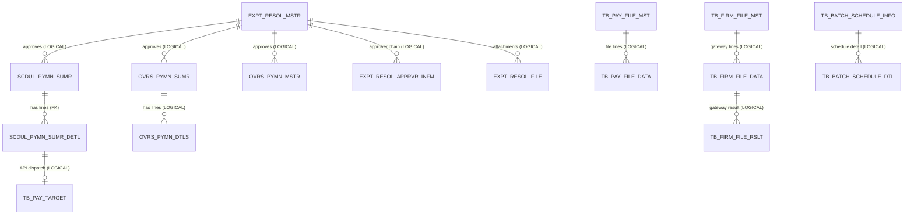

# Payment — ERD

**Module:** `domain/payment`
**Diagram source:** [`diagrams/payment-erd.mmd`](diagrams/payment-erd.mmd)
**Generated:** 2026-06-01 · from Flyway migrations + JPA entities.

Payment covers four scheduled-payment flows (internal transfer, vendor, expense, payroll — all sharing one master/detail pair), overseas payment, the approval box, the firm-banking **dispatch** chain, and special-character validation. All tables are tenant-scoped by `BIZ_KEY`.

Full attribute detail: [`diagrams/payment-erd.mmd`](diagrams/payment-erd.mmd).

> ⚠️ **Migration column regenerated from disk 2026-08-17.** The [2026-06-09 rebaseline](../flyway-migration-baseline.md)
> reassigned every Flyway number to a one-table-per-migration scheme; the values below name the migration
> that creates each table **today**. Rows marked **DROPPED** / **no refactor DDL migration** have no current
> migration — that is accurate, not a gap.

## Tables by sub-module

### Scheduled payment (internal transfer / vendor / expense / payroll)
| Table | Source | Purpose | PK |
|---|---|---|---|
| `SCDUL_PYMN_SUMR` | V86 | Batch master, discriminated by `SCDUL_PYMN_TYPE_CD` (00 payroll, 01 vendor, 02 expense, 03 internal) | `(BIZ_KEY, SCDUL_PYMN_NO)` |
| `SCDUL_PYMN_SUMR_DETL` | V87 | Per-recipient line of a batch | `(BIZ_KEY, SCDUL_PYMN_NO, SCDUL_PYMN_DETL_NO)` |
| `INTERNAL_TRANSFER_KEY_SEQ` | — **DROPPED** (historical `V131`) | ~~Java-side per-day `SCDUL_PYMN_NO` generator~~ — table, entity and repository all absent; the key funnels through `wb_get_next_val` | `(BIZ_KEY, KEY_DT)` |
| `SCDU_PYMN_SUMR_DETL_PAY_TARGET_CONN` | — **DROPPED** (historical `V188`) | 1:1 bridge from a detail line to its `TB_PAY_TARGET` dispatch row (API path) | `(BIZ_KEY, SCDUL_PYMN_NO, SCDUL_PYMN_DETL_NO)` |

### Overseas payment
| Table | Source | Purpose | PK |
|---|---|---|---|
| `OVRS_PYMN_SUMR` | V75 | Overseas batch master (Excel upload), `OVRS_PYMN_TYPE_CD` E/M | `(BIZ_KEY, OVRS_PYMN_NO)` |
| `OVRS_PYMN_MSTR` | V78 | Individual manual overseas payment master | `(BIZ_KEY, OVRS_PYMN_NO)` |
| `OVRS_PYMN_DTLS` | — **no refactor DDL migration** (external/live-JEX schema) | Detail line within an overseas batch | `(BIZ_KEY, OVRS_PYMN_NO, TRN_SEQ)` |
| `OVERSEAS_PAYMENT_KEY_SEQ` | — **DROPPED** (historical `V158`) | ~~Java-side per-day `OVRS_PYMN_NO` generator~~ — table, entity and repository all absent | `(BIZ_KEY, KEY_DT)` |

### Approval box
| Table | Source | Purpose | PK |
|---|---|---|---|
| `EXPT_RESOL_MSTR` | V59 | Approval request master (one per batch, all payment types) | `(BIZ_KEY, APPR_SEQ_NO)` |
| `EXPT_RESOL_APPRVR_INFM` | V56 | Approver chain row | `(BIZ_KEY, APPR_SEQ_NO, APPRVR_ID)` |
| `EXPT_RESOL_FILE` | V58 | Attachment uploaded with a request | `(BIZ_KEY, APPR_SEQ_NO, FILE_ID)` |

### Dispatch (firm banking)
| Table | Source | Purpose | PK |
|---|---|---|---|
| `TB_PAY_TARGET` | V109 | API-path dispatch request (one per line to a VND bank API) | `(TRAN_DT, BIZ_KEY, TRAN_SEQ)` |
| `TB_PAY_FILE_MST` | V107 | File-path dispatch header (non-VND, file batch) | `(TRAN_DT, BIZ_KEY, FILE_SEQ_NO)` |
| `TB_PAY_FILE_DATA` | V105 | File-path dispatch line | `(TRAN_DT, BIZ_KEY, FILE_SEQ_NO, SEQ)` |
| `TB_BATCH_SCHEDULE_INFO` | V96 | Per-bank batch schedule header (global, no BIZ_KEY) | `(BATCH_ID, OUT_BANK_CD)` |
| `TB_BATCH_SCHEDULE_DTL` | V95 | Schedule detail split by `ANT_DIV_CD` | `(BATCH_ID, OUT_BANK_CD, ANT_DIV_CD)` |
| `TB_FIRM_BAT_API_TRAN` | V99 | Batch-level API call audit | `(TRAN_DT, BIZ_KEY, TRAN_SEQ, API_TRAN_TP, OUT_BANK_CD, BANK_PRTN_ID)` |
| `TB_FIRM_FILE_MST` | V102 | Gateway-side file header | `(TRAN_DT, BIZ_KEY, FILE_SEQ_NO, FIRM_FILE_NM)` |
| `TB_FIRM_FILE_DATA` | V101 | Gateway-side file line (**PK omits BIZ_KEY** — DEV design) | `(TRAN_DT, FILE_SEQ_NO, FIRM_FILE_NM, SEQ)` |
| `TB_FIRM_FILE_RSLT` | V103 | Gateway response per line | `(TRAN_DT, BIZ_KEY, FIRM_FILE_NM, SEQ)` |

### Validation
| Table | Source | Purpose | PK |
|---|---|---|---|
| `BLOCKED_CHARS_RULE` | V14 | Per-bank/payment-type/field blocked-character ruleset (lookup) | `RULE_ID` |

## Key columns & conventions

- **Audit columns:** payment business tables use `REG_ID/REG_DTM/MOD_ID/MOD_DTM` `VARCHAR(14)`; dispatch (`TB_*`) tables use `REG_DTTM/MOD_DTTM`, `RQ_DTTM/RS_DTTM`. *(The `*_KEY_SEQ` helper tables used `TIMESTAMPTZ` — both were **dropped 2026-06-09/10**; noted for historical completeness only.)*
- **State / use flags:** `TRNF_YN` (dispatch complete) on the summary/master tables; `EXPT_RESOL_MSTR.DEL_YN`; `EXPT_RESOL_APPRVR_INFM.READ_YN`; `PROC_STAT` / `PROC_RSLT_DIV` on dispatch tables; `BLOCKED_CHARS_RULE.STATUS`.
- **Code / enum columns:** `SCDUL_PYMN_TYPE_CD`, `OVRS_PYMN_TYPE_CD` (E/M), `FEE_PAYER_CD` (O/S/B), `APPR_DV` / `APPR_STS` (0 draft / 1 pending / 2 approved / 4 rejected), `APPRVR_STTS` (P/A/R), `ANT_DIV_CD` (NAPAS/SWIFT/CITAD), `API_TRAN_TP`, `PYMN_TPYE` + `FIELD_CD` on `BLOCKED_CHARS_RULE`.
- **Important indexes:** `IX_SCDUL_PYMN_SUMR_BIZ_TYPE_REG`, `IX_SCDUL_PYMN_SUMR_DETL_BIZ_TRCO`, `IDX_OVRS_PYMN_SUMR_BIZ_DTM`, `IX_EXPT_RESOL_MSTR_BIZ_DRAFT_DATE`, `IDX_TB_PAY_TARGET_BIZ_TRAN`, `IDX_BLOCKED_CHARS_RULE_LOOKUP`.

## Relationships

| From | To | Kind | Via |
|---|---|---|---|
| `SCDUL_PYMN_SUMR` | `SCDUL_PYMN_SUMR_DETL` | **FK declared** | `(BIZ_KEY, SCDUL_PYMN_NO)` |
| `BUSI_INFM` | `SCDUL_PYMN_SUMR` | **FK declared** | `BIZ_KEY` |
| `BUSI_INFM` | `EXPT_RESOL_MSTR` | **FK declared** | `BIZ_KEY` |
| `EXPT_RESOL_MSTR` | `SCDUL_PYMN_SUMR` / `OVRS_PYMN_SUMR` / `OVRS_PYMN_MSTR` | **Logical — no FK** | `APPR_SEQ_NO` (nullable) |
| `EXPT_RESOL_MSTR` | `EXPT_RESOL_APPRVR_INFM` / `EXPT_RESOL_FILE` | **Logical — no FK** (deferred) | `(BIZ_KEY, APPR_SEQ_NO)` |
| `OVRS_PYMN_SUMR` | `OVRS_PYMN_DTLS` | **Logical — no FK** | `(BIZ_KEY, OVRS_PYMN_NO)` |
| `SCDUL_PYMN_SUMR_DETL` | `SCDU_PYMN_SUMR_DETL_PAY_TARGET_CONN` → `TB_PAY_TARGET` | **Logical — no FK** | `TRAN_DT, TRAN_SEQ` |
| `SCDUL_PYMN_SUMR_DETL` | `TB_PAY_FILE_DATA` | **Logical — no FK** | `PAY_TRAN_DT, PAY_FILE_SEQ_NO, PAY_SEQ` |
| `TB_PAY_FILE_MST` | `TB_PAY_FILE_DATA` | **Logical — no FK** | `(TRAN_DT, BIZ_KEY, FILE_SEQ_NO)` |
| `TB_FIRM_FILE_MST` | `TB_FIRM_FILE_DATA` → `TB_FIRM_FILE_RSLT` | **Logical — no FK** | `TRAN_DT, FILE_SEQ_NO, FIRM_FILE_NM, SEQ` |
| `TB_BATCH_SCHEDULE_INFO` | `TB_BATCH_SCHEDULE_DTL` | **Logical — no FK** | `(BATCH_ID, OUT_BANK_CD)` |
| `SCDUL_PYMN_SUMR_DETL` | `TRCO_INFM` (settings) | **Logical — no FK** | `TRCO_KEY` |
| `SCDUL_PYMN_SUMR_DETL` | `CHART_ACCT_INFM` (settings) | **Logical — no FK** | `CHART_ACCT_SEQ_NO` |

`BLOCKED_CHARS_RULE` is a standalone lookup — no joins from payment flows (consumed by `SpecialCharValidator`).

## Related docs

- Schema notes: [`../payment/internal-transfer-schema.md`](../payment/internal-transfer-schema.md), [`../payment/firm-banking-dispatch-schema.md`](../payment/firm-banking-dispatch-schema.md), [`../payment/firm-banking-dispatch-relationships.md`](../payment/firm-banking-dispatch-relationships.md)
- Business rules: [`../../../business-rules/`](../../business-rules/) · Feature specs: [`../../../features/`](../../../features/)
- JEX functional spec: [`../../../../jex/business-rules/payment.md`](../../../../../docs/jex/business-rules/)
