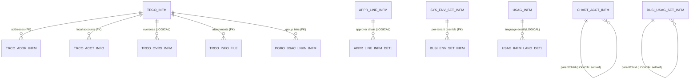

# Settings — ERD

**Module:** `domain/setting`
**Diagram source:** [`diagrams/settings-erd.mmd`](diagrams/settings-erd.mmd)
**Generated:** 2026-06-01 · from Flyway migrations + JPA entities.

Settings holds the configuration domain: bank-account authorization, chart of accounts, contacts, approval lines, firm-banking settings + history sources, ERP transaction history, VAS accounts, purpose/usage settings, environment settings, and login credentials. Most tables are tenant-scoped by `BIZ_KEY`; `TB_FIRM_BANK_CODE`, `SYS_ENV_SET_INFM`, and `USAG_INFM`/`USAG_INFM_LANG_DETL` are **global** lookups.

This is the module with the **most declared foreign keys** in the whole schema (the contacts and environment-settings sub-modules).

Full attribute detail: [`diagrams/settings-erd.mmd`](diagrams/settings-erd.mmd).

## Tables by sub-module

| Table | Sub-module | Source | Purpose | PK |
|---|---|---|---|---|
| `ACCT_AUTH_INFO` | bank-account | V153 (+V186) | Per-user/account authorization (view/withdraw/full) | `(BIZ_KEY, USER_ID, BANK_CD, ACCT_NO, AUTH_TYPE)` |
| `CHART_ACCT_INFM` | chart-of-accounts | V94 (+V191 seed) | Hierarchical GL account master | `(BIZ_KEY, CHART_ACCT_SEQ_NO)` |
| `TRCO_INFM` | contacts | V112 | Contact (trading-company) master | `TRCO_KEY` (global sequence) |
| `TRCO_ADDR_INFM` | contacts | V112 | Contact address history (current/previous) | `(TRCO_KEY, BIZ_KEY, TRCO_ADDR_KEY)` |
| `TRCO_ACCT_INFO` | contacts | V112 | Contact local bank-account details | `(BIZ_KEY, TRCO_KEY, TRCO_ACCT_KEY)` |
| `TRCO_OVRS_INFM` | contacts | V112 | Contact overseas beneficiary details | `(TRCO_KEY, BIZ_KEY, TRCO_OVRS_KEY)` |
| `PGRO_BSAC_LNKN_INFM` | contacts | V112 | Group/user → contact linkage (Buy/Sale) | `(BIZ_KEY, USER_ID, GRP_CD, TRCO_KEY)` |
| `TRCO_INFO_FILE` | contacts | V139 | Contact file-attachment metadata | `(TRCO_KEY, FILE_ID)` |
| `APPR_LINE_INFM` | approval-line | V90 (+V92) | Approval-line master (workflow) | `(BIZ_KEY, APPR_LINE_NO)` |
| `APPR_LINE_INFM_DETL` | approval-line | V90 (+V92) | Approver chain row (max 5) | `(BIZ_KEY, APPR_LINE_NO, APPRVR_ID)` |
| `TB_FIRM_CONF` | firm-banking-settings | V62 | Firm-banking channel binding (outbound config) | `(BIZ_KEY, OUT_BANK_CD, WDRL_ACT_NO)` |
| `TB_FIRM_TRAN` | firm-banking-history | V59 | Firm-banking gateway transaction log | `(TRAN_DT, BIZ_KEY, TRAN_SEQ)` |
| `TB_FIRM_BANK_CODE` | firm-banking-history | V59 (+V145 seed) | Bank-code dictionary (global) | `BANK_CD` |
| `NXSIAS_MODULE_TRAN_LOG_HIS` | firm-banking-history | V59 / V101 | NXISAS/GDT bridge audit log | `(BIZ_KEY, REG_DTM, UUID)` |
| `ERP_TRNS_HSTR` | erp-transaction-history | V71 (+V75) | ERP file-exchange ledger | `(BIZ_KEY, SEQ_NO)` |
| `BUSI_VAS_ACCT_INFM` | vas-account | V77 | VAS (virtual account) master | `(BIZ_KEY, VAS_ACCT_SEQ_NO)` |
| `USAG_INFM` | purpose-settings | V201 | Purpose/usage dictionary (global master) | `USE_USAG_CD` |
| `USAG_INFM_LANG_DETL` | purpose-settings | V201 | Per-language purpose name | `(USE_USAG_CD, LANG_CODE)` |
| `BUSI_USAG_SET_INFM` | purpose-settings | V80 | Per-tenant purpose/usage categorization | `(BIZ_KEY, USE_USAG_CD)` |
| `SYS_ENV_SET_INFM` | environment-settings | V69 | System-wide environment setting codes | `ENV_SET_INF` |
| `BUSI_ENV_SET_INFM` | environment-settings | V69 | Per-tenant environment settings | `(BIZ_KEY, ENV_SET_INF)` |
| `BANK_CERT_INFO` | login-credentials | V100 (+V182) | Bank login credentials (encrypted) | `(BIZ_KEY, SEQ_NO)` |
| `GDT_CERT_INFO` | login-credentials | V128 | Tax-portal (GDT) login credentials (encrypted) | `(BIZ_KEY, SEQ_NO)` |

## Key columns & conventions

- **Audit columns:** mostly `REG_ID/REG_DTM/MOD_ID/MOD_DTM` `VARCHAR(14)`. `TB_FIRM_CONF` / `TB_FIRM_TRAN` / `TB_FIRM_BANK_CODE` use `REG_DTTM/MOD_DTTM`. `BUSI_USAG_SET_INFM` and `BUSI_ENV_SET_INFM` carry **only** `MOD_ID/MOD_DTM` (no `REG_*`). `ERP_TRNS_HSTR` and `PGRO_BSAC_LNKN_INFM` are append-only (`REG_*` only). `SYS_ENV_SET_INFM` has no audit columns.
- **Soft-delete / use flags:** `ACCT_AUTH_INFO.USE_YN`, `CHART_ACCT_INFM.DEL_YN` (revive-on-create / archive-rename-on-delete), `TRCO_INFM.TRCO_INQ_YN`, `BUSI_VAS_ACCT_INFM.DEL_YN`, `USAG_INFM.DEL_YN`, `BUSI_USAG_SET_INFM.USE_YN`/`DISP_YN`.
- **Code / enum columns:** `AUTH_TYPE` (V/W/F), `CHART_ACCT_INFM.STTS` (A/I) + `CAL_RULE` (P/M), `PGRO_BSAC_LNKN_INFM.GRP_CD` (B/S), `TB_FIRM_CONF.ORG_STAT` (0–3) + `FILE_TYPE` (SHB/WRB), `BUSI_VAS_ACCT_INFM.VAS_ACCT_TYPE` (0/1/2) + `STTS` (A/I), `ERP_TRNS_HSTR.ERP_TYPE` (W/E/D) + `TRNS_TYPE_CD` (01–17), `NXISAS_TYPE`/`NXISAS_JOB`, `CERT_INFO_DV`.
- **Self-referencing hierarchies:** `CHART_ACCT_INFM.PARENT_CHART_ACCT_CD` and `BUSI_USAG_SET_INFM.PARENT_USE_USAG_CD` are logical self-references (validated in service, no FK).
- **Refactor type deviations (Hibernate `validate`):** `APPR_LINE_NO` NUMERIC→BIGINT (V92), `APPRVR_DISP_ORD` NUMERIC→INTEGER (V92), `ERP_TRNS_HSTR.SEQ_NO`/`FILE_SIZE` NUMERIC→BIGINT (V75), `DISP_ORD` NUMERIC→INTEGER (V89). DB stays otherwise column-for-column with DEV.

## Relationships

| From | To | Kind | Via |
|---|---|---|---|
| `TRCO_INFM` | `TRCO_ADDR_INFM` | **FK declared** (`trco_acct_info_fk01` family; addr FK deferrable) | `TRCO_KEY` |
| `TRCO_INFM` | `TRCO_ACCT_INFO` | **FK declared** (DEFERRABLE) | `TRCO_KEY` |
| `TRCO_INFM` | `TRCO_INFO_FILE` | **FK declared** | `TRCO_KEY` |
| `TRCO_INFM` | `PGRO_BSAC_LNKN_INFM` | **FK declared** (DEFERRABLE) | `TRCO_KEY` |
| `BUSI_INFM` | `PGRO_BSAC_LNKN_INFM` | **FK declared** | `BIZ_KEY` |
| `BUSI_INFM` | `BUSI_ENV_SET_INFM` | **FK declared** | `BIZ_KEY` |
| `SYS_ENV_SET_INFM` | `BUSI_ENV_SET_INFM` | **FK declared** | `ENV_SET_INF` |
| `TRCO_INFM` | `TRCO_OVRS_INFM` | **Logical — no FK** | `TRCO_KEY` |
| `APPR_LINE_INFM` | `APPR_LINE_INFM_DETL` | **Logical — no FK** | `APPR_LINE_NO` |
| `CHART_ACCT_INFM` | `CHART_ACCT_INFM` (self) | **Logical — no FK** | `PARENT_CHART_ACCT_CD` |
| `BUSI_USAG_SET_INFM` | `BUSI_USAG_SET_INFM` (self) | **Logical — no FK** | `PARENT_USE_USAG_CD` |
| `USAG_INFM` | `USAG_INFM_LANG_DETL` | **Logical — no FK** | `USE_USAG_CD` |
| `TB_FIRM_BANK_CODE` | `TB_FIRM_CONF` | **Logical — no FK** (view join) | `OUT_BANK_CD = BANK_CD` |
| `ACCT_MSTR` (banking) | `TB_FIRM_CONF` | **Logical — no FK** (view LEFT JOIN) | `WDRL_ACT_NO = ACCT_NO` |
| `ACCT_MSTR` (banking) | `ACCT_AUTH_INFO` | **Logical — no FK** | `BANK_CD, ACCT_NO` |
| `USER_INFM` (shared) | `ACCT_AUTH_INFO` | **Logical — no FK** | `USER_ID` |

## Related docs

- Schema notes: [`../settings/firm-banking-settings-schema.md`](../settings/firm-banking-settings-schema.md), [`../settings/firm-banking-history-schema.md`](../settings/firm-banking-history-schema.md), [`../settings/erp-transaction-history-schema.md`](../settings/erp-transaction-history-schema.md), [`../settings/purpose-settings-schema.md`](../settings/purpose-settings-schema.md), [`../contacts-schema.md`](../contacts-schema.md), [`../chart-of-accounts.md`](../chart-of-accounts.md), [`../vas-account.md`](../vas-account.md)
- Business rules: [`../../../business-rules/`](../../business-rules/) · Feature specs: [`../../../features/`](../../../features/)
- JEX functional spec: [`../../../../jex/business-rules/settings.md`](../../../../../docs/jex/business-rules/)
